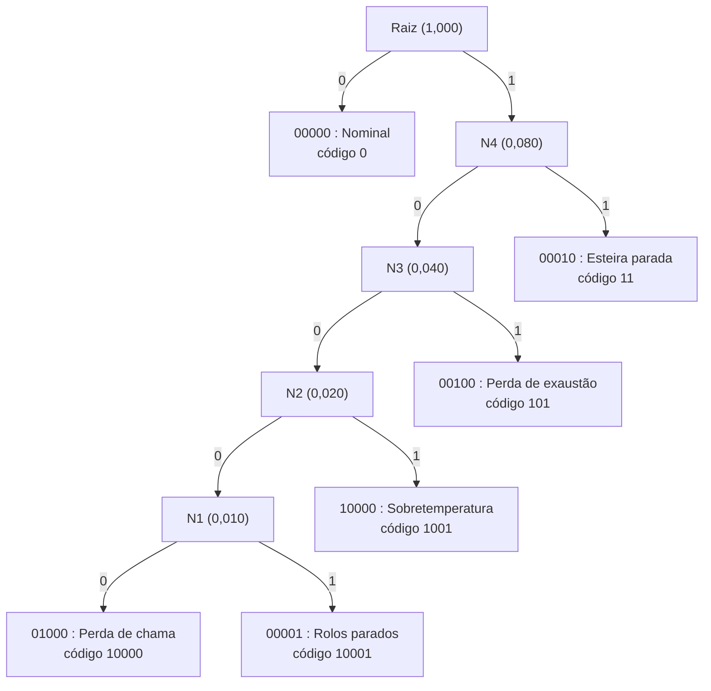

# Aula 20: Algoritmo de Huffman na Telemetria do Forno de Torra — Fábrica de Paçoca

**Disciplina:** ECAA08 — Automática (2026.2) — UNIFEI  
**Projeto:** SCADA-Core Automática / Linha de Produção de Paçoca  
**Equipe:** Grupo 7  
**Perfil:** Engenharia de Controle e Automação (Matemática Discreta & Árvores Binárias)  

---

## 1. Escopo e Arquitetura do Sistema de Transmissão

O **CLP 02** (Setor 200 — Torra e Despeliculagem) envia ao servidor **SCADA-Core** o estado do **Forno de Torra**, o equipamento mais crítico da linha (risco de incêndio e de poeira combustível, ver `planta-pacoca.html`). A transmissão usa a rede industrial da planta (PROFINET/Modbus). Sem compressão, o estado de cada varredura ocupa uma palavra binária de tamanho fixo.

Considera-se o **vetor de 5 bits de desvio** (bit = 1 indica condição anormal), montado com as tags ISA-5.1 já catalogadas na Etapa 01:

| Bit | Tag | Proposição (Etapa 01) | Bit = 1 significa |
| :---: | :--- | :---: | :--- |
| 1 | `TT-201` | $t_2$ | Temperatura de torra acima de $160^\circ\text{C}$ |
| 2 | `TS-201` | $\neg c_1$ | Perda de chama do queimador |
| 3 | `FS-201` | $\neg f_2$ | Perda de fluxo de exaustão |
| 4 | `M-201` | $\neg m_2$ | Esteira do forno parada |
| 5 | `M-202` | $\neg m_3$ | Rolos despeliculadores parados |

Com varredura de $100\text{ ms}$, são $10$ amostras por segundo, cada uma com $5$ bits no formato fixo. Como o forno opera em regime estável quase todo o tempo, o estado "tudo normal" domina a telemetria, e é exatamente essa assimetria que a **codificação de Huffman** explora para reduzir o volume transmitido **sem perda de informação** (*lossless*).

> **Premissa de modelagem:** as probabilidades da seção 2 são **estimativas de projeto** do grupo, não medições de campo. Com dados reais do historiador, elas devem ser recalculadas.

## 2. Modelo Probabilístico e Algoritmo de Huffman

O alfabeto discreto $S = \{s_1, \dots, s_6\}$ reúne as combinações do vetor `[TT-201, TS-201, FS-201, M-201, M-202]` consideradas no modelo (um desvio por vez).

### Matriz de Probabilidades Operacionais

| Código do Estado | Instrumento em nível lógico 1 | Condição operacional | Probabilidade $P(s_i)$ |
| --- | --- | --- | --- |
| `00000` | Nenhum | Operação nominal estável | $0{,}920$ ($92{,}0\%$) |
| `00010` | `M-201` | Esteira do forno parada | $0{,}040$ ($4{,}0\%$) |
| `00100` | `FS-201` | Perda de fluxo de exaustão | $0{,}020$ ($2{,}0\%$) |
| `10000` | `TT-201` | Sobretemperatura ($> 160^\circ\text{C}$) | $0{,}010$ ($1{,}0\%$) |
| `01000` | `TS-201` | Perda de chama do queimador | $0{,}007$ ($0{,}7\%$) |
| `00001` | `M-202` | Rolos despeliculadores parados | $0{,}003$ ($0{,}3\%$) |

### Construção da Árvore de Huffman

A cada passo, os dois nós de menor peso são unidos em um nó intermediário cujo peso é a soma:

1. **Combinação 1:** `00001` ($0{,}003$) + `01000` ($0{,}007$) → nó $N_1$ com peso $0{,}010$.
2. **Combinação 2:** `10000` ($0{,}010$) + $N_1$ ($0{,}010$) → nó $N_2$ com peso $0{,}020$.
3. **Combinação 3:** `00100` ($0{,}020$) + $N_2$ ($0{,}020$) → nó $N_3$ com peso $0{,}040$.
4. **Combinação 4:** `00010` ($0{,}040$) + $N_3$ ($0{,}040$) → nó $N_4$ com peso $0{,}080$.
5. **Combinação 5:** $N_4$ ($0{,}080$) + `00000` ($0{,}920$) → **raiz** com peso $1{,}000$.



Atribuindo `0` ao ramo mais pesado e `1` ao mais leve, obtém-se o dicionário de **códigos de prefixo** (nenhum código é prefixo de outro):

| Estado original (fixo: 5 bits) | Código de Huffman | Comprimento $l(s_i)$ |
| --- | --- | --- |
| `00000` | `0` | 1 bit |
| `00010` | `11` | 2 bits |
| `00100` | `101` | 3 bits |
| `10000` | `1001` | 4 bits |
| `01000` | `10000` | 5 bits |
| `00001` | `10001` | 5 bits |


### Avaliação de Desempenho e Economia de Banda

* **Entropia de Shannon:**

$$H(S) = -\sum_{i=1}^{6} P(s_i)\log_2 P(s_i) \approx 0{,}5510 \text{ bits/símbolo}$$

* **Comprimento médio da palavra-código:**

$$L = \sum_{i=1}^{6} P(s_i)\, l(s_i) = 0{,}92\cdot 1 + 0{,}04\cdot 2 + 0{,}02\cdot 3 + 0{,}01\cdot 4 + 0{,}007\cdot 5 + 0{,}003\cdot 5 = 1{,}1500 \text{ bits/símbolo}$$

* **Redução de banda em relação ao formato fixo:**

$$\text{Redução} = \left(1 - \frac{L}{L_{\text{fixo}}}\right) \times 100\% = \left(1 - \frac{1{,}1500}{5}\right) \times 100\% = 77{,}00\%$$

* **Eficiência do código:** $\eta = H/L \approx 47{,}9\%$. Vale lembrar que $H \le L < H + 1$ vale para todo código de prefixo. A eficiência fica abaixo de 50% porque o estado nominal tem $P = 0{,}92$ e Huffman não pode gastar menos de **1 bit** por símbolo. Para chegar mais perto de $H$, seria preciso codificar **blocos** de varreduras consecutivas (extensão da fonte).

## 3. Protocolo de Enquadramento e Integração CLP/SCADA

### Estrutura do Quadro de Transmissão

Cada quadro agrupa **100 varreduras (10 s)** para amortizar o cabeçalho:

```
+-----------+-----------+-----------+------------------------+--------------+
| Header    | Count     | Length    | Huffman Payload        | CRC-16       |
| 8 bits    | 8 bits    | 8 bits    | bits codificados + pad | 16 bits      |
| 0xA5      | nº amost. | bytes     |                        | CCITT-FALSE  |
+-----------+-----------+-----------+------------------------+--------------+
```

O campo **Count** é necessário porque o payload é completado com zeros até fechar o último byte, e esse preenchimento seria decodificado como símbolos `0` (operação nominal) inexistentes. Com `Count`, o decodificador para exatamente na última amostra real.

### Algoritmo de Processamento

* **Codificação no CLP 02:** a cada varredura, o CLP lê as entradas, monta o vetor de 5 bits, consulta o dicionário de Huffman e insere os bits no buffer de saída; a cada 100 varreduras fecha o quadro e calcula o CRC-16.
* **Decodificação no servidor SCADA:** o servidor navega pela árvore de Huffman (`0` à esquerda, `1` à direita) até uma folha. Como o código é de prefixo, a decodificação é determinística e custa $\mathcal{O}(k)$ por símbolo, com $k \le 5$ iterações.
* **Integridade:** se o CRC-16 não confere (por exemplo, por ruído eletromagnético perto do forno e dos inversores), o quadro é **descartado** e o SCADA mantém o último estado válido com *flag* de diagnóstico para o operador.
* **Independência do SIS:** a compressão atua só no transporte para supervisão. O intertravamento do forno (ver Aula 21) é executado localmente no CLP e **não depende** deste link.

## 4. Resultados da Validação (notebook)

Simulação com $10.000$ varreduras (≈ $16{,}7$ min de operação), semente fixa:

| Métrica | Resultado |
| :--- | :--- |
| Volume sem compressão | $50.000$ bits ($6{,}10$ KB) |
| Volume com Huffman | $11.535$ bits ($1{,}41$ KB) |
| Redução de volume | $76{,}93\%$ (teórico: $77{,}00\%$) |
| Decodificação | Idêntica à original (*lossless* verificado) |
| Quadros com CRC-16 | $100$ quadros: tamanho médio $19{,}9$ B contra $68$ B no formato fixo equivalente |
| Quadro com $1$ bit invertido | Rejeitado pelo CRC-16 |

## 5. Entregável da Aula 20

* **Notebook `20 - Algoritmo de Huffman.ipynb`:** construção da árvore com *min-heap* determinístico, verificação do código de prefixo e da soma de Kraft, simulação de transmissão, codificação/decodificação de quadros com CRC-16 e gráficos de desempenho, aplicados ao Forno de Torra do Grupo 7.
