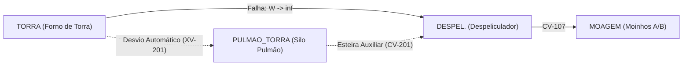

# Aula 15: Simulação de Vazamentos e Desvio Automático

**Disciplina:** ECAA08 — Automática (2026.2) — UNIFEI  
**Projeto:** SCADA-Core Automática / Linha de Produção de Paçoca  
**Equipe:** Grupo 7  
**Perfil:** Engenharia de Controle e Automação (Matemática Discreta & Teoria dos Grafos)  

---

## 1. Fundamentos Matemáticos: Reconfiguração Dinâmica de Grafos em Tempo Real

Na detecção de uma anomalia operacional — como entupimento por acúmulo de pasta oleosa de amendoim, queda de pressão diferencial em dutos de transporte pneumático ou falha mecânica de atuador em um segmento de transporte $(u, v)$ —, o sistema SCADA executa a **punição topológica**:

$$W(u, v) \leftarrow \infty$$

e recalcula instantaneamente a rota ótima de processo via **Algoritmo de Dijkstra** para realizar a comutação automática das válvulas de bloqueio ($XV$) e redirecionamento de esteiras.

---

## 2. Aprofundamento Teórico

### 2.1. Grafos Dinâmicos e o Conceito de Reponderação

Um **grafo dinâmico** é formalmente definido pela tripla temporal $G_t = (V_t, E_t, W_t)$, onde o conjunto de arestas e/ou os pesos variam em função do tempo, em contraste com os grafos estáticos estudados nas Aulas 11 a 14. 

A técnica de reponderação adotada no SCADA-Core — atribuir $W(u, v) \leftarrow \infty$ a um trecho comprometido — é a estratégia mais elegante para representar mudanças topológicas sem exigir realocação de memória ou reindexação de matrizes:
1. Em vez de remover fisicamente o nó ou a aresta da estrutura de dados, o algoritmo atribui um custo infinito.
2. Isso garante que nenhum algoritmo de caminho mínimo jamais selecionará a aresta punida.
3. Preserva-se intacto o registro histórico no *Historian* de que a conexão física existe, encontrando-se apenas temporariamente isolada pelo intertravamento de segurança.

---

### 2.2. Recomputar do Zero vs. Algoritmos Incrementais

A estratégia de **recomputar o Algoritmo de Dijkstra do zero** a cada evento de contingência possui complexidade assintótica $O((|V| + |E|) \log |V|)$. 
* Para malhas industriais locais (dezenas a centenas de nós, como a fábrica de paçoca), o tempo computacional de execução situa-se na faixa de **$0{,}05\text{ ms}$ a $0{,}30\text{ ms}$** em processadores comuns de CLP/IPC.
* Em sistemas de distribuição geográfica massiva (como malhas de transporte de grãos em escala nacional com mais de $10^5$ vértices), a literatura recomenda **Árvores de Caminho Mínimo Dinâmicas** (*Dynamic Shortest Path Trees* — Ramalingam & Reps), que recalculam apenas os ramos da árvore afetados pela aresta modificada. No escopo da automação de processo, o recálculo completo de Dijkstra é determinístico, previsível e livre de condições de corrida.

---

### 2.3. Tempo de Decisão como Métrica de Engenharia (IEC 61511 e SIS)

O tempo medido pelo notebook (`Tempo_Decisão_ms`) é um indicador fundamental de **Segurança Funcional**. Em sistemas instrumentados de segurança (SIS — *Safety Instrumented Systems*), a norma internacional **IEC 61511** define o **Tempo de Resposta de Segurança do Processo** (*Process Safety Time* — PST) como o intervalo máximo tolerável entre a ocorrência de uma condição perigosa e a transição da planta para um estado seguro.

$$\text{PST} \geq T_{\text{detecção}} + T_{\text{decisão}} + T_{\text{atuação}}$$

Como demonstrado nas simulações do Grupo 7:
* $T_{\text{decisão}} < 1\text{ ms}$ (frações de milissegundo no motor algorítmico);
* $T_{\text{atuação}} \approx 1{,}5\text{ a } 4{,}0\text{ s}$ (tempo mecânico de fechamento e pressurização de válvulas borboleta e gaveta pneumáticas).

**Conclusão Operacional:** O gargalo temporal da segurança e contingência reside na dinâmica mecânica dos atuadores de campo, provando que o motor de grafos do SCADA-Core opera com folga de mais de 3 ordens de magnitude em relação à dinâmica física da planta.

---

### 2.4. Conectividade, Pontes (*Bridges*) e Vértices de Articulação

A simulação de contingência levanta uma questão topológica essencial: **quais trechos da rede, se isolados, provocariam a parada total obrigatória da fábrica?**

* **Ponte (*Bridge*):** Uma aresta cuja remoção aumenta o número de componentes conexos do grafo (desconecta a rede). Formalmente, uma aresta $(u, v)$ é uma ponte se e somente se ela não pertence a nenhum ciclo dirigido ou ciclo não-dirigido subjacente.
* **Vértice de Articulação (*Cut Vertex*):** Um equipamento cuja inoperância isola a recepção da expedição (ex: a Prensa `PRN-401`, que centraliza toda a compactação antes da embalagem).
* **Algoritmo de Tarjan (1974):** Através de uma única busca em profundidade (DFS) em tempo $O(|V| + |E|)$, calcula para cada nó o valor de menor ancestral alcançável (*low-link*), detectando preventivamente todas as pontes da malha de transporte.

No trajeto modelado entre a Torra e a Despeliculagem, o trecho direto `TORRA -> DESPEL.` **não é uma ponte**, pois a rota de contingência alternativa via `PULMAO_TORRA` fecha um ciclo alternativo de processo, garantindo continuidade operacional sem abortar a batelada.

---

### 2.5. Resiliência de Rede: $k$-Conectividade de Arestas

Um grafo é dito **$k$-aresta-conexo** se a desconexão entre dois nós de processo exige a falha de pelo menos $k$ arestas simultâneas.
* A interconexão entre dosagem e homogeneização na fábrica de paçoca é **$2$-aresta-conexa**, graças à redundância em paralelo do Moinho A (`MOI-301A`) e Moinho B (`MOI-301B`).
* A existência da Moega Pulmão (`MOE-302_Pulmao`) entre o Homogeneizador e a Prensa garante redundância de amortecimento de fluxo, prevenindo transbordamentos caso a prensa reduza temporariamente sua taxa de ciclos.

---

## 3. Exemplo Resolvido

**Pergunta de Engenharia:**  
Durante a operação contínua, o sensor de corrente do motor da esteira de transferência `CV-106` (`TORRA -> DESPEL.`) detecta sobrecarga térmica e desarma o contator. O que ocorre no sistema supervisório?

**Resolução Passo a Passo:**
1. O CLP 02 gera a interrupção de desarme e transmite o alarme ao SCADA-Core.
2. O SCADA isola a aresta: $W(\text{TORRA}, \text{DESPEL.}) \leftarrow \infty$ e $A[\text{TORRA}][\text{DESPEL.}] \leftarrow 0$.
3. O algoritmo de Dijkstra é invocado entre `RECEPCAO` e `EMBALAGEM`.
4. Como o trecho principal possui peso infinito, o relaxamento seleciona o ramo alternativo:
   $$\text{TORRA} \xrightarrow{9{,}0\text{m } (XV\text{-}201)} \text{PULMAO\_TORRA} \xrightarrow{10{,}0\text{m } (CV\text{-}201)} \text{DESPEL.}$$
5. A nova rota total passa de $138{,}0\text{ m}$ para $143{,}0\text{ m}$ ($+5{,}0\text{ m}$).
6. O SCADA envia comandos aos CLPs para comutar a válvula desviadora pneumática $XV\text{-}201$ e ligar a esteira $CV\text{-}201$, mantendo a produção ininterrupta.

---

## 4. Atividades de Investigação

1. **Simulação de Dupla Falha:** Bloqueie simultaneamente o trecho principal `TORRA -> DESPEL.` e o desvio `TORRA -> PULMAO_TORRA`. Qual é o resultado retornado pelo algoritmo de Dijkstra? Qual comando de segurança o SCADA deve enviar aos queimadores do forno de torra?
2. **Avaliação de Ponte Única:** Verifique se o trecho `RECEPCAO -> LIMPEZA` é uma ponte. Proponha um duto de descarte/recirculação para elevar a confiabilidade desse estágio.
3. **Medição de Desempenho:** Execute o método `tratar_falha` em um laço de 1.000 iterações e plote o histograma de latência computacional. O tempo máximo ultrapassa $1{,}0\text{ ms}$?
4. **Análise de Custo-Benefício:** Calcule a perda financeira de parada de linha na fábrica de paçoca (capacidade nominal: $500\text{ kg/h}$ a $\text{R\$ } 25{,}00\text{/kg}$) durante um período de manutenção corretiva de 4 horas caso não existisse a rota de desvio automático.

---

## 5. Entregável da Aula 15

* **Simulador de Falhas e Desvio Automático em Python:** Módulo `SistemaDesvioAutomatico` validado no Jupyter Notebook complementar com recálculo em frações de milissegundo, teste de asserção de rota ativa e emissão de relatório em tabela ASCII pura.

