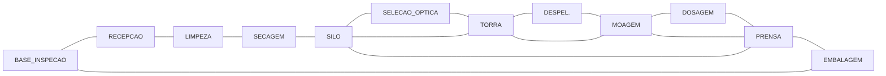

# Aula 16: Problemas Eulerianos e Inspeção de Infraestrutura

**Disciplina:** ECAA08 — Automática (2026.2) — UNIFEI  
**Projeto:** SCADA-Core Automática / Linha de Produção de Paçoca  
**Equipe:** Grupo 7  
**Perfil:** Engenharia de Controle e Automação (Matemática Discreta & Teoria dos Grafos)  

---

## 1. Fundamentos Matemáticos: Teorema de Euler e Circuitos Eulerianos

Um **Circuito Euleriano** em um grafo não-dirigido conexo $G = (V, E)$ existe se e somente se **todos os seus vértices possuírem grau par**:

$$\forall v \in V, \quad \deg(v) \equiv 0 \pmod 2$$

Em grafos dirigidos, a condição necessária e suficiente exige balanceamento exato de fluxo em cada vértice: $\deg^+(v) = \deg^-(v)$ para todo $v \in V$.

Na automação da manutenção preditiva da fábrica de paçoca, um robô móvel de inspeção autônoma (ou drone com sensor de ultrassom e câmera termográfica) deve percorrer todos os trechos de esteiras, dutos pneumáticos e estruturas fabris para detecção de vibração, corrosão e acúmulo de pó de amendoim sem duplicar rotas, minimizando o consumo de bateria e o tempo de parada.

---

## 2. Aprofundamento Teórico

### 2.1. Contexto Histórico: O Problema das Sete Pontes de Königsberg

A Teoria dos Grafos como disciplina da matemática e da ciência da computação nasceu formalmente em **1736**, quando **Leonhard Euler** publicou a solução do clássico problema das sete pontes da cidade de Königsberg (atual Kaliningrado). A cidade dividia-se em quatro regiões de terra banhadas pelo rio Pregel, interconectadas por sete pontes. O desafio consistia em encontrar um percurso pedestre que atravessasse cada uma das sete pontes exatamente uma vez e retornasse ao ponto inicial.

Euler provou rigorosamente que tal passeio era **impossível**, demonstrando que qualquer circuito fechado exige que toda região possua um número par de pontes conectadas. Ao abstrair as massas de terra como vértices e as pontes como arestas, Euler fundou a topologia e a teoria das redes que utilizamos hoje no planejamento de rotas autônomas.

---

### 2.2. Definição Formal e Prova do Teorema (Caso Não-Dirigido)

**Teorema de Euler (1736):** Um grafo conexo $G = (V, E)$ admite um circuito euleriano se e somente se todo vértice $v \in V$ tem grau par.

* **Prova da Necessidade ($\implies$):**  
  Suponha que exista um circuito euleriano $C$. Para qualquer vértice $v \in V$, cada passagem de $C$ por $v$ utiliza exatamente uma aresta para entrar em $v$ e uma aresta distinta para sair de $v$, adicionando $+2$ ao grau de $v$. Como $C$ é fechado, o vértice inicial/final também tem sua aresta de partida emparelhada com a aresta de chegada final. Como cada aresta do grafo é utilizada exatamente uma vez, o grau de cada vértice deve ser a soma de pares de arestas, portanto $\deg(v)$ é par para todo $v \in V$.

* **Prova da Suficiência ($\impliedby$, Construtiva via Subcircuitos):**  
  Como todo vértice tem grau par e o grafo é conexo com pelo menos uma aresta, partindo de qualquer nó arbitrário $u$, podemos construir um ciclo fechado simples $C_1$: ao entrar em qualquer nó intermediário por uma aresta não utilizada, como o grau é par, sempre restará pelo menos uma aresta livre para sair, até que o único nó sem arestas de saída remanescentes seja o nó inicial $u$. Se $C_1$ contiver todas as arestas de $E$, o circuito está completo. Caso contrário, removendo as arestas de $C_1$, os vértices do subgrafo remanescente continuam com grau par. Pela conexidade, existe ao menos um nó $w \in C_1$ incidente a uma aresta não utilizada. Repete-se o processo a partir de $w$ para gerar $C_2$, intercalando $C_2$ em $C_1$. Por indução finita, todas as arestas são incorporadas em um único circuito euleriano. $\blacksquare$

---

### 2.3. Adaptação para Dígrafos vs. Grafos de Inspeção Não-Dirigidos

* Em **dígrafos de processo** (fluxo de produto nas Aulas 11 a 15), a condição euleriana exige $\deg^+(v) = \deg^-(v)$, expressando a conservação mássica de entradas e saídas.
* Na **malha de inspeção física** desta aula, os trechos são modelados como arestas **não-dirigidas** ($u \leftrightarrow v$). O robô de inspeção sobre trilhos ou piso fabril pode trafegar em ambos os sentidos da esteira ou do duto para captar leituras de termografia e espessura de parede metálica por ultrassom, aplicando-se diretamente o critério de grau par simples.

---

### 2.4. O Algoritmo de Hierholzer (1873) — Análise Detalhada

O algoritmo de **Hierholzer** operacionaliza a prova construtiva de suficiência de forma ótima, empregando uma pilha explícita LIFO e remoção dinâmica de arestas visitadas:

1. Inicializa a pilha com o nó de partida (ex: `BASE_INSPECAO`).
2. Enquanto o nó no topo da pilha (`u`) possuir arestas incidentes não visitadas:
   - Seleciona uma aresta $(u, v)$, remove-a do grafo e empilha `v`.
3. Quando o nó no topo da pilha não possuir mais arestas incidentes livres:
   - Desempilha `u` e adiciona-o ao início da lista do circuito final.
4. Ao esvaziar a pilha, a lista resultante representa o Circuito Euleriano completo.

**Complexidade Computacional:**
* **Tempo:** $O(|E|)$ — Cada aresta da malha é inspecionada e removida exatamente uma vez. Essa é a complexidade assintótica estritamente ótima, pois qualquer algoritmo de inspeção completa precisa necessariamente avaliar cada aresta ao menos uma vez.
* **Espaço:** $O(|V| + |E|)$ para manter as listas de adjacência e a pilha de rastreamento.

---

### 2.5. Relação com o Problema do Carteiro Chinês

Quando uma malha fabril física real **não é euleriana** (ou seja, possui vértices de grau ímpar), o robô é forçado a percorrer alguns trechos mais de uma vez para cobrir toda a fábrica. O problema de encontrar o percurso fechado de menor custo que percorre cada aresta ao menos uma vez é conhecido como o **Problema do Carteiro Chinês** (*Chinese Postman Problem* — Kwan Mei-Ko, 1962).

Sua resolução polinomial envolve:
1. Identificar o conjunto de vértices de grau ímpar $V_{\text{ímpar}}$ (cuja cardinalidade é sempre par pelo Lema do Aperto de Mãos).
2. Calcular a matriz de distâncias mínimas entre todos os pares de $V_{\text{ímpar}}$ via Algoritmo de Dijkstra (Aula 14).
3. Resolver o **Emparelhamento Perfeito de Custo Mínimo** (*Minimum Weight Perfect Matching*) em tempo $O(|V|^3)$ via **Algoritmo de Blossom** de Jack Edmonds (1965).
4. Duplicar na malha física as arestas correspondentes aos menores caminhos do emparelhamento, tornando todos os graus pares e executando Hierholzer sobre o multigrafo resultante.

---

## 3. Exemplo Resolvido

**Pergunta de Engenharia:**  
A malha física de manutenção preditiva da fábrica de paçoca possui 12 equipamentos interconectados em anel (`I-01` a `I-12`) mais 4 ramais diagonais de reforço estrutural (`I-13: SILO-TORRA`, `I-14: TORRA-MOAGEM`, `I-15: MOAGEM-PRENSA`, `I-16: PRENSA-SILO`). A malha é euleriana?

**Resolução:**  
Calculamos os graus de todos os 12 vértices da malha:
* `BASE_INSPECAO`: conexões com Recepção e Embalagem $\implies \deg = 2$ (par).
* `RECEPCAO`, `LIMPEZA`, `SECAGEM`, `SELECAO_OPTICA`, `DESPEL.`, `DOSAGEM`, `EMBALAGEM`: cada um ligado a exatamente dois vizinhos no anel $\implies \deg = 2$ (par).
* `SILO`: conectado a Secagem, Seleção Óptica, Torra e Prensa $\implies \deg = 4$ (par).
* `TORRA`: conectado a Seleção Óptica, Despeliculador, Silo e Moagem $\implies \deg = 4$ (par).
* `MOAGEM`: conectado a Despeliculador, Dosagem, Torra e Prensa $\implies \deg = 4$ (par).
* `PRENSA`: conectado a Dosagem, Embalagem, Moagem e Silo $\implies \deg = 4$ (par).

Como **todos os 12 vértices possuem grau par ($2$ ou $4$)**, o critério do Teorema de Euler é satisfeito com exatidão (`Grafo é Euleriano: True`), permitindo a geração de uma rota sem repetição pelo Algoritmo de Hierholzer.

---

## 4. Atividades de Investigação

1. **Alteração Topológica:** Suponha a adição de um novo ramal de inspeção entre `LIMPEZA` e `TORRA`. Quais vértices tornam-se de grau ímpar? A malha continuará euleriana?
2. **Resolução de Não-Euleriano:** Para a malha modificada no item 1, aplique o princípio do Carteiro Chinês para determinar qual trecho deve ser percorrido duas vezes para fechar o circuito com mínima distância adicional.
3. **Ponto de Partida Alternativo:** O circuito euleriano gerado com início no `SILO` tem a mesma distância total do circuito que parte de `BASE_INSPECAO`? Justifique com base no comprimento das arestas.
4. **Inspeção com Múltiplos Robôs:** Se a fábrica dispuser de 2 robôs de manutenção, como decompor o circuito euleriano em duas trilhas balanceadas de tempo mínimo?

---

## 5. Entregável da Aula 16

* **Módulo de Inspeção Euleriana em Python:** Implementação da classe `GrafoInspecaoEuleriano` contendo os métodos `verificar_euleriano` e `calcular_circuito_hierholzer`, validada com asserts no Jupyter Notebook complementar.
