# Relatório Técnico: Otimização Topológica da Linha de Produção de Paçoca

**Dimensionamento Mínimo de Malha de Utilidades e Redes SCADA com Algoritmos de Kruskal e Prim**

**Disciplina:** ECAA08 — Automática (2026.2) — UNIFEI  
**Projeto:** SCADA-Core Automática / Linha de Produção de Paçoca  
**Equipe:** Grupo 7  
**Perfil:** Engenharia de Controle e Automação (Matemática Discreta & Árvores Geradoras Mínimas)  

---

### Informações do Projeto

| Parâmetro | Detalhe |
| :--- | :--- |
| **Unidade Industrial** | Fábrica Agroindustrial de Paçoca (Setores 100, 200, 300 e 400) |
| **Aplicação** | Interconexão de Utilidades (*Pipe Racks* de Ar Comprimido e Vapor) e Barramento SCADA (PROFINET/Modbus) |
| **Método Formulado** | Árvore Geradora Mínima (MST — *Minimum Spanning Tree*) |
| **Código do Projeto** | ECAA08-SISTEMA-SCADA / Grupo 7 |

---

## 1. Contextualização e Objetivo de Engenharia de Automação

No projeto de automação e instrumentação industrial de uma planta agroindustrial de alimentos (beneficiamento contínuo de amendoim e manufatura de paçoca), a infraestrutura eletromecânica de interconexão — composta por leitos de tubulação de utilidades (*pipe racks*), eletrocalhas industriais para sinal e conduítes para barramentos de comunicação SCADA — constitui um dos principais custos de capital (*CAPEX*) e de manutenção operacional (*OPEX*).

Na fábrica de paçoca do Grupo 7, os quatro setores produtivos compartilham linhas vitais de suprimento físico e controle digital:
1. **Linha de Ar Comprimido Industrial (6 a 8 bar):** Alimentação pneumática indispensável para as pistolas de ejeção por sopro da selecionadora óptica de grãos (Setor 200), atuadores das válvulas de dosagem (`XV-301..304`, Setor 300), cilindros da prensa rotativa (`PRN-401`, Setor 400) e mecanismos de corte e rejeição na esteira de embalagem *Flow-Pack* (`M-401`).
2. **Linha de Utilidades Térmicas (Gás Combustível GN/GLP e Vapor):** Interligação de queimadores do forno contínuo de torra (`FOR-201`), trocadores de calor do secador de leito fluidizado (`SEC-101`) e camisas de arrefecimento dos moinhos de martelo (`MOI-301`).
3. **Barramento de Comunicação SCADA e Segurança Funcional:** Interligação de alta velocidade (PROFINET RT / Modbus TCP) entre os controladores programáveis locais (`CLP 01` a `CLP 04`) e os nós de telemetria de campo ao painel central na Sala de Controle.

Instalar canaletas e leitos em todas as rotas concebivelmente possíveis geraria um excesso de cabos e tubos, elevando custos desnecessariamente e criando complexidade desproporcional para expansões futuras.

O objetivo deste estudo de engenharia é modelar o *layout* fabril como um grafo não direcionado e ponderado $G = (V, E, w)$ e determinar a topologia ótima de menor extensão linear contínua por meio dos algoritmos de **Kruskal** e **Prim**, garantindo 100% de conectividade entre todos os ativos industriais da planta.

---

## 2. Formulação Matemática da Rede Fabril

O chão de fábrica é modelado formalmente pela tripla $G = (V, E, w)$:
* **Vértices ($V$):** Conjunto dos 8 equipamentos mecânicos e instrumentos operacionais críticos ($|V| = 8$):
  * $v_1$: `SILO-101` — Silo de Recepção e Armazenamento de Amendoim Cru (`LT-101`, Setor 100)
  * $v_2$: `SEC-101` — Secador Rotativo de Leito Fluidizado (`TT-101`, `FS-101`, Setor 100)
  * $v_3$: `FOR-201` — Forno Contínuo de Torra a Gás (`TT-201`, `TS-201`, `XV-201`, Setor 200)
  * $v_4$: `DES-202` — Rolos Despeliculadores e Ciclone de Extração de Película (`M-202`, Setor 200)
  * $v_5$: `MAN-301` — Manifold de Dosagem Gravimétrica (`WT-301`, `WT-302`, `WT-303`, Setor 300)
  * $v_6$: `MOI-301` — Conjunto de moinhos de martelos `MOI-301A` (operante) e `MOI-301B` (reserva), tratado como um único nó de layout (`M-301`, Setor 300)
  * $v_7$: `HOM-301` — Misturador Homogeneizador Helicoidal de Duplo Eixo (`HOM-301`, Setor 300)
  * $v_8$: `PRN-401` — Prensa Rotativa de Compactação e Embalagem (`PS-401`, `M-401`, Setor 400)

* **Arestas ($E$):** As 14 canaletas civis e leitos de *pipe rack* cuja passagem física é construtivamente viável segundo o memorial de layout fabril ($|E| = 14$):

| Rota / Canaleta | Conexão Física de Ativos | Setores Envolvidos | Distância Real $w(e)$ | Função Técnica Primária |
| :---: | :---: | :---: | :---: | :--- |
| $e_1$ | `DES-202` $\leftrightarrow$ `MAN-301` | Setor 200 $\leftrightarrow$ Setor 300 | $10{,}0\text{ m}$ | Transferência de grãos torrados e linha de ar comprimido |
| $e_2$ | `FOR-201` $\leftrightarrow$ `DES-202` | Setor 200 $\leftrightarrow$ Setor 200 | $12{,}0\text{ m}$ | Duto de descarga de amendoim torrado e exaustão |
| $e_3$ | `MAN-301` $\leftrightarrow$ `MOI-301` | Setor 300 $\leftrightarrow$ Setor 300 | $12{,}0\text{ m}$ | Alimentação da moega dosadora ao moinho de martelos |
| $e_4$ | `HOM-301` $\leftrightarrow$ `PRN-401` | Setor 300 $\leftrightarrow$ Setor 400 | $14{,}0\text{ m}$ | Transporte helicoidal de massa úmida para compactação |
| $e_5$ | `SILO-101` $\leftrightarrow$ `SEC-101` | Setor 100 $\leftrightarrow$ Setor 100 | $15{,}0\text{ m}$ | Alimentação de amendoim cru em casca ao secador |
| $e_6$ | `DES-202` $\leftrightarrow$ `MOI-301` | Setor 200 $\leftrightarrow$ Setor 300 | $15{,}0\text{ m}$ | Leito transversal de utilidades entre torra e moagem |
| $e_7$ | `MOI-301` $\leftrightarrow$ `HOM-301` | Setor 300 $\leftrightarrow$ Setor 300 | $16{,}0\text{ m}$ | Linha de pasta moída com camisa de resfriamento |
| $e_8$ | `FOR-201` $\leftrightarrow$ `MOI-301` | Setor 200 $\leftrightarrow$ Setor 300 | $18{,}0\text{ m}$ | Eletrocalha de intertravamento de segurança funcional |
| $e_9$ | `SEC-101` $\leftrightarrow$ `FOR-201` | Setor 100 $\leftrightarrow$ Setor 200 | $20{,}0\text{ m}$ | Rota de grãos secos pré-aquecidos para a câmara de torra |
| $e_{10}$ | `MAN-301` $\leftrightarrow$ `HOM-301` | Setor 300 $\leftrightarrow$ Setor 300 | $22{,}0\text{ m}$ | Linha de injeção direta de aditivos, açúcar e glucose |
| $e_{11}$ | `SEC-101` $\leftrightarrow$ `DES-202` | Setor 100 $\leftrightarrow$ Setor 200 | $25{,}0\text{ m}$ | Canaleta perimetral de retorno de ar e drenagem |
| $e_{12}$ | `MOI-301` $\leftrightarrow$ `PRN-401` | Setor 300 $\leftrightarrow$ Setor 400 | $28{,}0\text{ m}$ | Leito secundário de comando de parada de emergência |
| $e_{13}$ | `FOR-201` $\leftrightarrow$ `MAN-301` | Setor 200 $\leftrightarrow$ Setor 300 | $30{,}0\text{ m}$ | Rota lateral de cabeamento e instrumentação |
| $e_{14}$ | `SILO-101` $\leftrightarrow$ `DES-202` | Setor 100 $\leftrightarrow$ Setor 200 | $35{,}0\text{ m}$ | Tronco primário de ar comprimido do galpão de insumos |

**Comprimento total linear da malha pré-otimização:**
$$W_{\text{inicial}} = \sum_{e \in E} w(e) = 247{,}00\text{ metros}$$

---

## 3. Algoritmo de Kruskal (Abordagem Baseada em Arestas)

O algoritmo de Kruskal aplica uma estratégia gulosa (*greedy*) descentralizada:
1. As arestas de $E$ são dispostas em ordem não decrescente de peso $w(e)$.
2. Cada aresta é avaliada iterativamente através da estrutura de conjuntos disjuntos (*Disjoint Set Union - DSU / Union-Find*).
3. A aresta é aceita se conectar duas componentes desconexas; se ambos os nós já possuírem o mesmo representante de conjunto, a aresta é rejeitada por formar ciclo redundante.
4. O algoritmo interrompe imediatamente ao selecionar exatamente $|V| - 1 = 8 - 1 = 7$ arestas.

### Tabela de Execução do Algoritmo de Kruskal

| Passo | Aresta $e$ | Conexão Avaliada | Comprimento $w(e)$ | Ciclo Detectado via DSU? | Decisão de Projeto | Justificativa Técnica |
| :---: | :---: | :---: | :---: | :---: | :---: | :--- |
| **1** | $(v_4, v_5)$ | `DES-202` $\leftrightarrow$ `MAN-301` | $10{,}0\text{ m}$ | Não | **INCLUÍDA** | Une componentes $\{v_4\}$ e $\{v_5\}$ |
| **2** | $(v_3, v_4)$ | `FOR-201` $\leftrightarrow$ `DES-202` | $12{,}0\text{ m}$ | Não | **INCLUÍDA** | Une componente $\{v_3\}$ ao bloco $\{v_4, v_5\}$ |
| **3** | $(v_5, v_6)$ | `MAN-301` $\leftrightarrow$ `MOI-301` | $12{,}0\text{ m}$ | Não | **INCLUÍDA** | Incorpora $\{v_6\}$ ao bloco $\{v_3, v_4, v_5\}$ |
| **4** | $(v_7, v_8)$ | `HOM-301` $\leftrightarrow$ `PRN-401` | $14{,}0\text{ m}$ | Não | **INCLUÍDA** | Une componentes $\{v_7\}$ e $\{v_8\}$ |
| **5** | $(v_1, v_2)$ | `SILO-101` $\leftrightarrow$ `SEC-101` | $15{,}0\text{ m}$ | Não | **INCLUÍDA** | Une componentes $\{v_1\}$ e $\{v_2\}$ |
| **6** | $(v_4, v_6)$ | `DES-202` $\leftrightarrow$ `MOI-301` | $15{,}0\text{ m}$ | **Sim** | **REJEITADA** | Formaria ciclo ($v_4 - v_5 - v_6$) |
| **7** | $(v_6, v_7)$ | `MOI-301` $\leftrightarrow$ `HOM-301` | $16{,}0\text{ m}$ | Não | **INCLUÍDA** | Conecta bloco do processo ao bloco de envase |
| **8** | $(v_3, v_6)$ | `FOR-201` $\leftrightarrow$ `MOI-301` | $18{,}0\text{ m}$ | **Sim** | **REJEITADA** | Formaria ciclo ($v_3 - v_4 - v_5 - v_6$) |
| **9** | $(v_2, v_3)$ | `SEC-101` $\leftrightarrow$ `FOR-201` | $20{,}0\text{ m}$ | Não | **INCLUÍDA** | Conecta o bloco de entrada ao núcleo fabril |

*(Parada antecipada: 7 arestas selecionadas; as 5 rotas restantes de 22 m, 25 m, 28 m, 30 m e 35 m foram descartadas automaticamente por redundância de ciclo).*

**Comprimento total da infraestrutura via Kruskal:**
$$W_{\text{Kruskal}} = 10 + 12 + 12 + 14 + 15 + 16 + 20 = 99{,}00\text{ metros}$$

---

## 4. Algoritmo de Prim (Abordagem Baseada em Vértices)

O algoritmo de Prim desenvolve uma única arborescência contínua a partir de um vértice raiz. Para este projeto de engenharia, a raiz foi fixada em $v_1$ (`SILO-101`), que corresponde ao ponto de entrada da matéria-prima e onde fica localizado o galpão de utilidades e compressores da planta.

A cada iteração, o algoritmo inspeciona a fronteira de corte $(S, V \setminus S)$ e seleciona a aresta de custo mínimo que anexa um novo nó ao conjunto visitado $S$, utilizando uma fila de prioridade (*Min-Heap*).

### Tabela de Execução do Algoritmo de Prim

| Iteração | Vértices Conectados ($S$) | Arestas da Fronteira de Corte Elegíveis | Aresta Selecionada | Nó Incorporado | Custo $w(e)$ |
| :---: | :--- | :--- | :---: | :---: | :---: |
| **Inicial** | $\{v_1\}$ | $(v_1, v_2): 15{,}0$, $(v_1, v_4): 35{,}0$ | $(v_1, v_2)$ | $v_2$ (`SEC-101`) | $15{,}0\text{ m}$ |
| **1** | $\{v_1, v_2\}$ | $(v_2, v_3): 20{,}0$, $(v_2, v_4): 25{,}0$, $(v_1, v_4): 35{,}0$ | $(v_2, v_3)$ | $v_3$ (`FOR-201`) | $20{,}0\text{ m}$ |
| **2** | $\{v_1, v_2, v_3\}$ | $(v_3, v_4): 12{,}0$, $(v_3, v_6): 18{,}0$, $(v_2, v_4): 25{,}0$, $(v_3, v_5): 30{,}0$ | $(v_3, v_4)$ | $v_4$ (`DES-202`) | $12{,}0\text{ m}$ |
| **3** | $\{v_1, v_2, v_3, v_4\}$ | $(v_4, v_5): 10{,}0$, $(v_4, v_6): 15{,}0$, $(v_3, v_6): 18{,}0$ | $(v_4, v_5)$ | $v_5$ (`MAN-301`) | $10{,}0\text{ m}$ |
| **4** | $\{v_1, v_2, v_3, v_4, v_5\}$ | $(v_5, v_6): 12{,}0$, $(v_4, v_6): 15{,}0$, $(v_5, v_7): 22{,}0$ | $(v_5, v_6)$ | $v_6$ (`MOI-301`) | $12{,}0\text{ m}$ |
| **5** | $\{v_1, \dots, v_6\}$ | $(v_6, v_7): 16{,}0$, $(v_5, v_7): 22{,}0$, $(v_6, v_8): 28{,}0$ | $(v_6, v_7)$ | $v_7$ (`HOM-301`) | $16{,}0\text{ m}$ |
| **6** | $\{v_1, \dots, v_7\}$ | $(v_7, v_8): 14{,}0$, $(v_6, v_8): 28{,}0$ | $(v_7, v_8)$ | $v_8$ (`PRN-401`) | $14{,}0\text{ m}$ |

**Comprimento total da infraestrutura via Prim:**
$$W_{\text{Prim}} = 15 + 20 + 12 + 10 + 12 + 16 + 14 = 99{,}00\text{ metros}$$

---

## 5. Representação Esquemática da Rede e Topologia MST

O diagrama topológico abaixo ilustra o resultado da otimização: os trechos contínuos em verde representam as 7 canaletas e eletrocalhas que compõem a espinha dorsal física (MST), enquanto os trechos tracejados em vermelho indicam as canaletas descartadas para evitar laços fechados:

```mermaid
graph LR
    subgraph S100["Setor 100: Recepção e Secagem"]
        SILO["SILO-101 (Recepção)"]
        SEC["SEC-101 (Secador)"]
    end

    subgraph S200["Setor 200: Torra e Despeliculagem"]
        FORNO["FOR-201 (Forno de Torra)"]
        DESP["DES-202 (Despeliculador)"]
    end

    subgraph S300["Setor 300: Dosagem e Moagem"]
        MAN["MAN-301 (Dosagem)"]
        MOI["MOI-301 (Moinho)"]
        HOM["HOM-301 (Homogeneizador)"]
    end

    subgraph S400["Setor 400: Compactação e Envase"]
        PRN["PRN-401 (Prensa e Embalagem)"]
    end

    %% Arestas selecionadas pela MST (linha dupla/sólida)
    SILO ===|15m - MST| SEC
    SEC ===|20m - MST| FORNO
    FORNO ===|12m - MST| DESP
    DESP ===|10m - MST| MAN
    MAN ===|12m - MST| MOI
    MOI ===|16m - MST| HOM
    HOM ===|14m - MST| PRN

    %% Arestas descartadas (redundantes - tracejadas)
    DESP -.-|15m - Descartada| MOI
    FORNO -.-|18m - Descartada| MOI
    MAN -.-|22m - Descartada| HOM
    SEC -.-|25m - Descartada| DESP
    MOI -.-|28m - Descartada| PRN
    FORNO -.-|30m - Descartada| MAN
    SILO -.-|35m - Descartada| DESP

    classDef mst fill:#dcfce7,stroke:#16a34a,stroke-width:2px;
    classDef desc fill:#fee2e2,stroke:#dc2626,stroke-width:1px,stroke-dasharray: 4 4;
```

---

## 6. Análise Comparativa e Decisão de Engenharia

> [!NOTE]
> **Resultados Globais da Otimização Topológica:**
> * **Comprimento Inicial da Malha Completa:** $247{,}00\text{ metros}$
> * **Comprimento da Árvore Geradora Mínima:** $99{,}00\text{ metros}$
> * **Economia Linear de Infraestrutura:** $\mathbf{59{,}92\%}$ ($148{,}00\text{ metros}$ a menos de eletrocalhas e tubos)
> * **Equivalência Estrita dos Métodos:** $W_{\text{Kruskal}} = W_{\text{Prim}} = 99{,}00\text{ m}$ (Verificado)

### Diretrizes de Engenharia para Aplicação em Chão de Fábrica

Embora ambos os algoritmos garantam a otimalidade global e a mesma extensão de $99\text{ metros}$, o contexto prático de implantação define a utilidade de cada método:

* **Algoritmo de Kruskal $\mathcal{O}(|E| \log |E|)$ — Indicado para a Fase de Projeto Básico (*FEED*):**  
  Na fase de especificação preliminar e orçamentação (*Front-End Engineering Design*), a equipe de automação analisa a matriz de distâncias globalmente em lote. O algoritmo de Kruskal é ideal para levantar a lista de materiais (*Bill of Materials* - BOM), cotar tubos de aço inox e canaletas galvanizadas com fornecedores e definir o orçamento preliminar de CAPEX sem depender da definição física exata da sala de controle.

* **Algoritmo de Prim $\mathcal{O}(|E| \log |V|)$ — Indicado para a Fase de Execução e Montagem em Campo (*Commissioning*):**  
  Na etapa de obra civil e montagem eletromecânica, o algoritmo de Prim é significativamente superior. Como ele expande uma árvore estritamente conexa a partir do nó raiz (`SILO-101`), as equipes de montagem podem lançar o cabeamento de rede PROFINET e as linhas de ar comprimido de forma sequencial e ininterrupta. Isto viabiliza testes ponto a ponto e comissionamento progressivo setor por setor (Setor 100 $\to$ Setor 200 $\to$ Setor 300 $\to$ Setor 400) sem deixar segmentos isolados ou desenergizados no galpão.

* **Distinção Crítica entre MST Física e Redes Ethernet RSTP (Aula 23):**  
  Um erro comum de engenharia é confundir a **MST física** com o **protocolo de árvore geradora de rede (RSTP / IEEE 802.1w)**. A MST de Kruskal/Prim minimiza o **custo de implantação física** (metros de cabos e canaletas). Já o RSTP constrói uma **Árvore de Caminhos Mínimos (SPT)** calculada via Dijkstra a partir do switch raiz (*Root Bridge*), visando minimizar a latência de tráfego de dados e eliminar *broadcast storms*, mesmo que a soma dos enlaces seja maior que a MST.

---

## 7. Referências Técnicas e Normativas

1. CORMEN, T. H.; LEISERSON, C. E.; RIVEST, R. L.; STEIN, C. **Algoritmos: Teoria e Prática**. 3. ed. Rio de Janeiro: Elsevier, 2012.
2. ISA-5.1. **Instrumentation Symbols and Identification**. Research Triangle Park: International Society of Automation, 2009.
3. IEC 61508. **Functional Safety of Electrical/Electronic/Programmable Electronic Safety-Related Systems**. International Electrotechnical Commission, 2010.
4. IEEE 802.1w. **IEEE Standard for Local and metropolitan area networks — Common specifications — Part 3: Media Access Control (MAC) Bridges — Amendment 2: Rapid Reconfiguration**, 2001.
5. PETERS, M. S.; TIMMERHAUS, K. D. **Plant Design and Economics for Chemical Engineers**. 5th ed. New York: McGraw-Hill, 2003.
6. ANVISA. **RDC nº 275: Regulamento Técnico de Procedimentos Operacionais Padronizados aplicados aos Estabelecimentos Produtores/Industrializadores de Alimentos**, 2002.
