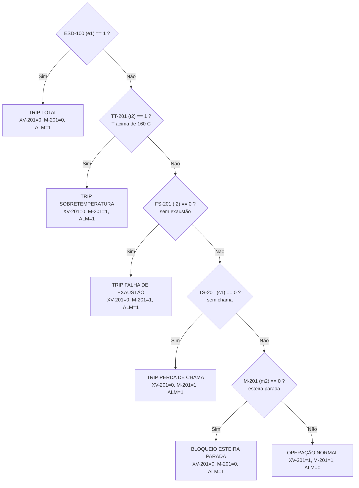
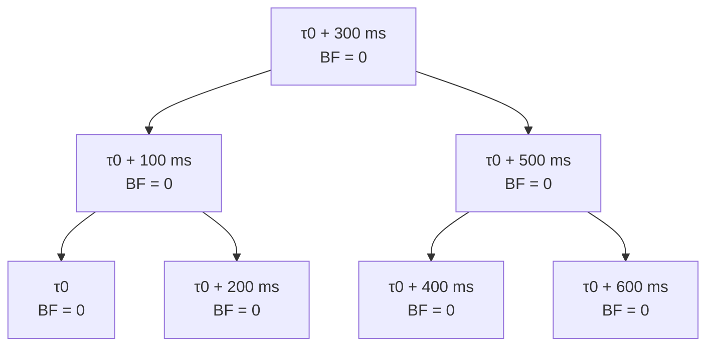
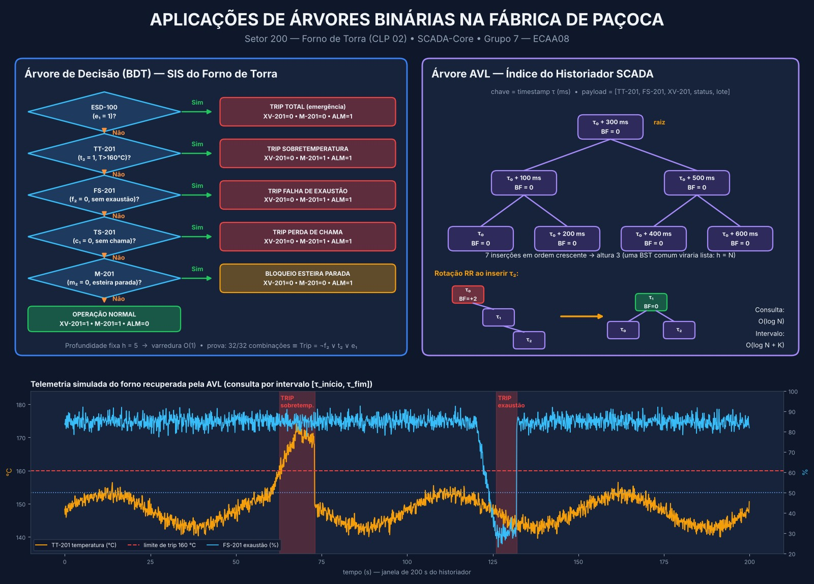

# Aula 21: Árvores Binárias na Fábrica de Paçoca — BDT do Forno de Torra e AVL do Historiador SCADA

**Disciplina:** ECAA08 — Automática (2026.2) — UNIFEI  
**Projeto:** SCADA-Core Automática / Linha de Produção de Paçoca  
**Equipe:** Grupo 7  
**Perfil:** Engenharia de Controle e Automação (Matemática Discreta & Árvores Binárias)  

---

| Especificação Técnica | Detalhes |
| :--- | :--- |
| **Unidade operacional** | Setor 200 — Forno de Torra e Despeliculagem (CLP 02) e Historiador SCADA-Core |
| **Domínio de engenharia** | Segurança funcional (IEC 61508 / IEC 61511), segurança de alimentos (APPCC) e matemática discreta |
| **Estruturas de dados** | Árvore Binária de Decisão (BDT) e Árvore Binária de Busca Auto-Balanceada (AVL) |
| **Tags ISA-5.1** | `TT-201`, `TS-201`, `FS-201`, `XV-201`, `M-201`, `ALM-201`, `ESD-100` (catálogo da Etapa 01) |

---

## 1. Árvore Binária de Decisão (BDT) — Intertravamento (SIS) do Forno de Torra

### 1.1 Contextualização da Engenharia de Processos

O **Forno Contínuo de Torra** (gás GN/GLP, operação abaixo do limite de segurança de $160^\circ\text{C}$) combina chama aberta, ar quente e poeira de amendoim, e por isso é o ponto de maior risco de incêndio da planta (`planta-pacoca.html`). A proteção é um **Sistema Instrumentado de Segurança (SIS)** que fecha a válvula de corte rápido de combustível `XV-201` quando uma condição insegura é detectada.

A Etapa 01 já formalizou essa lógica como $\text{Trip}_{\text{Forno}} \equiv \neg f_2 \lor t_2 \lor e_1$. Nesta aula, a mesma lógica é reorganizada como uma **árvore binária de decisão** de profundidade fixa, avaliada em **ordem de gravidade** e com curto-circuito.

### 1.2 Formalização Matemática

A árvore de segurança é um grafo acíclico orientado $T = (V, E)$ em que:

* $V = V_{\text{interno}} \cup V_{\text{folha}}$: os nós internos contêm **predicados booleanos** das tags ISA-5.1; as folhas contêm o **estado de atuação** $(\text{XV-201},\ \text{M-201},\ \text{ALM-201})$.
* $E$: arestas direcionadas rotuladas $\{1 = \text{Sim},\ 0 = \text{Não}\}$.

### 1.3 Topologia da Árvore de Intertravamento

### 1.4 Mapeamento dos Estados dos Instrumentos

| Nível ($h$) | Nó de decisão | Tag | Condição lógica | `XV-201` | `M-201` | `ALM-201` | Estado funcional |
| :---: | :---: | :---: | :---: | :---: | :---: | :---: | :--- |
| **0 (raiz)** | `ESD-100` | Botão de emergência | $e_1 = 1$ | 0 | 0 | 1 | Parada total de emergência |
| **1** | `TT-201` | Transmissor de temperatura | $t_2 = 1$ ($T > 160^\circ\text{C}$) | 0 | 1 | 1 | Trip por sobretemperatura |
| **2** | `FS-201` | Chave de fluxo (exaustão) | $f_2 = 0$ | 0 | 1 | 1 | Trip por falha de exaustão |
| **3** | `TS-201` | Sensor de chama | $c_1 = 0$ | 0 | 1 | 1 | Trip por perda de chama |
| **4** | `M-201` | Esteira do forno | $m_2 = 0$ | 0 | 0 | 1 | Bloqueio por esteira parada |
| **5 (folha)** | — | Todos conformes | $e_1 = t_2 = 0,\ f_2 = c_1 = m_2 = 1$ | 1 | 1 | 0 | Forno em produção normal |

Nos trips térmico, de exaustão e de chama, a esteira **continua ligada** para descarregar o forno e evitar que a carga queime enquanto o gás está cortado. No `ESD-100` tudo é desenergizado. A BDT é avaliada com o forno em regime (estado `P4_TORRANDO` da Aula 24). Na partida, a purga e a ignição são sequenciadas pela rede de Petri da Aula 24: `XV-201` abre e `TS-201` tem um tempo de segurança para confirmar a chama; sem confirmação, o forno vai para bloqueio (`T4_FALHA_IGNICAO`).

### 1.5 Prova de Equivalência com a Etapa 01 e Complexidade

1. **Verificação exaustiva:** o notebook testa as $2^5 = 32$ combinações de $(e_1, t_2, f_2, c_1, m_2)$ e confirma que (a) sempre que $\neg f_2 \lor t_2 \lor e_1$ vale, `XV-201` está fechada; e (b) `XV-201` só fica aberta quando $\neg e_1 \land \neg t_2 \land f_2 \land c_1 \land m_2$. Resultado: **0 violações em 32 casos**.
2. **Determinismo temporal:** a árvore tem altura fixa $h = 5$, logo o pior caso por varredura é $O(h) = O(1)$, sem laços de duração variável. Na simulação (Python em PC) o custo foi de ≈ $2{,}6\ \mu\text{s}$ por varredura; esse número é ilustrativo e o tempo real deve ser validado no ciclo de varredura do CLP.

---

## 2. Árvore AVL — Índice de Séries Temporais do Historiador SCADA

### 2.1 Contextualização da Engenharia de Dados Industriais

O Historiador registra a telemetria do forno a cada $100\text{ ms}$ ($10\text{ Hz}$): `TT-201`, `FS-201`, `TS-201`, `XV-201` e o estado do SIS, junto com o **lote** em processamento. Há dois usos práticos:

* **Análise de causa-raiz (RCA):** após um trip, recuperar rapidamente a janela de tempo em torno do evento.
* **Rastreabilidade (APPCC):** identificar quais lotes estavam no forno durante um desvio, para segregação e análise.

### 2.2 Por que balancear?

As amostras chegam em ordem **estritamente crescente** de *timestamp*, que é exatamente o pior caso para uma BST comum: a árvore degenera em uma lista ($h = N$) e a busca vira $O(N)$. A **AVL** mantém a altura em $O(\log N)$ por rotações a cada inserção. No notebook, com $N = 2000$ chaves crescentes, a AVL teve altura **11**, enquanto a BST sem balanceamento teve altura **2000**.

### 2.3 Estrutura do Nó

$$N = \Big\langle \tau,\; h,\; \text{Esq},\; \text{Dir},\; \mathbf{D}(\tau) \Big\rangle, \qquad \mathbf{D}(\tau) = \big[ T_{\text{TT-201}},\; F_{\text{FS-201}},\; \text{XV-201},\; \text{Status}_{\text{SIS}},\; \text{lote} \big]$$

em que $\tau \in \mathbb{N}$ é o *timestamp* UNIX em milissegundos (chave de ordenação) e $h$ é a altura da subárvore.

### 2.4 Topologia e Fator de Balanceamento

Inserindo 7 amostras consecutivas ($\tau_0, \tau_0+100, \dots, \tau_0+600\text{ ms}$), as rotações resultam em uma árvore perfeita de altura 3:

Para cada nó $n$, o fator de balanceamento é mantido por rotações:

$$BF(n) = h(T_{\text{dir}}) - h(T_{\text{esq}}) \in \{-1,\ 0,\ +1\}$$

Quando $|BF(n)| > 1$ após uma inserção, aplica-se uma rotação em tempo $O(1)$:

* **Rotação simples à esquerda (RR):** $BF(n) = +2$ e $BF(\text{filho}_{\text{dir}}) \ge 0$. É o caso típico de dados em ordem crescente (por exemplo, inserir $\tau_0, \tau_1, \tau_2$ torna $\tau_1$ a raiz).
* **Rotação simples à direita (LL):** $BF(n) = -2$ e $BF(\text{filho}_{\text{esq}}) \le 0$.
* **Rotação dupla direita-esquerda (RL):** $BF(n) = +2$ e $BF(\text{filho}_{\text{dir}}) < 0$.
* **Rotação dupla esquerda-direita (LR):** $BF(n) = -2$ e $BF(\text{filho}_{\text{esq}}) > 0$.

### 2.5 Complexidade e Percurso

| Operação | Complexidade (pior caso garantido) |
| :--- | :---: |
| Inserção de amostra | $O(\log_2 N)$ |
| Consulta pontual por $\tau$ (auditoria) | $O(\log_2 N)$ |
| Consulta por intervalo $[\tau_1, \tau_2]$ | $O(\log_2 N + K)$ |

$N$ é o total de amostras indexadas e $K$ o número de registros retornados. A consulta por intervalo faz um **percurso em ordem** podado:

$$\text{Percurso}(n) = \text{Percurso}(n.\text{esq}) \longrightarrow \text{Processa}(\mathbf{D}(n.\tau)) \longrightarrow \text{Percurso}(n.\text{dir})$$

Como a chave $\tau$ é estritamente ordenada, o percurso devolve os dados em ordem cronológica e só visita as subárvores que intersectam o intervalo.

### 2.6 Aplicação: RCA do Primeiro Trip por Sobretemperatura

Na simulação, o primeiro trip por sobretemperatura ocorreu em $\tau = 1794934862700$ ms, com $T = 161{,}47^\circ\text{C}$. A consulta por intervalo $[\tau - 2\text{ s},\ \tau + 2\text{ s}]$ devolveu **41 registros** em ordem cronológica, mostrando a subida da temperatura até o cruzamento do limite e o fechamento de `XV-201`. A mesma estrutura identificou o lote `L-20261117-02` como o que estava no forno no evento.

---

## 3. Síntese e Comparativo de Aplicação na Planta

| Propriedade | BDT (SIS do forno) | AVL (Historiador) |
| :--- | :--- | :--- |
| **Objetivo industrial** | Intertravamento e segurança funcional | Armazenamento e consulta de telemetria |
| **Elemento-chave** | Predicado booleano das tags ISA-5.1 | *Timestamp* UNIX $\tau$ (ms) |
| **Modificação da estrutura** | Estática (definida em projeto) | Dinâmica (inserções contínuas a $10\text{ Hz}$) |
| **Critério de desempenho** | Tempo de varredura limitado, $O(1)$ | Consultas em séries temporais, $O(\log N)$ |
| **Resultado verificado** | 32/32 combinações ≡ regra da Etapa 01 | Altura 11 (AVL) contra 2000 (BST degenerada) |
| **Conformidade** | IEC 61508 / IEC 61511 (SIS) | APPCC / RDC 275 (rastreabilidade) |

> **Limite do modelo:** os dados são sintéticos, com falhas injetadas em janelas conhecidas, e os tempos foram medidos em Python. O SIS real deve ser validado no CLP e **não pode depender** do historiador.

## 4. Entregável da Aula 21

* **Notebook `21 - Arvores Binarias.ipynb`:** geração de telemetria sintética do forno, classe `BDT_SIS_Forno` com verificação exaustiva das 32 combinações, classe `HistoriadorAVL` com rotações e verificação de invariantes, benchmark contra busca linear e BST degenerada, e consulta de RCA/rastreabilidade, aplicados ao Forno de Torra do Grupo 7.
