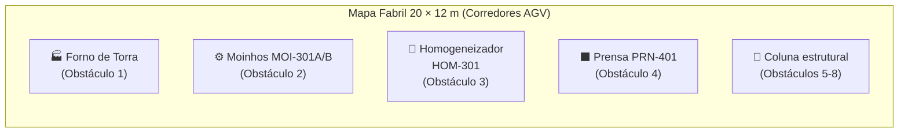
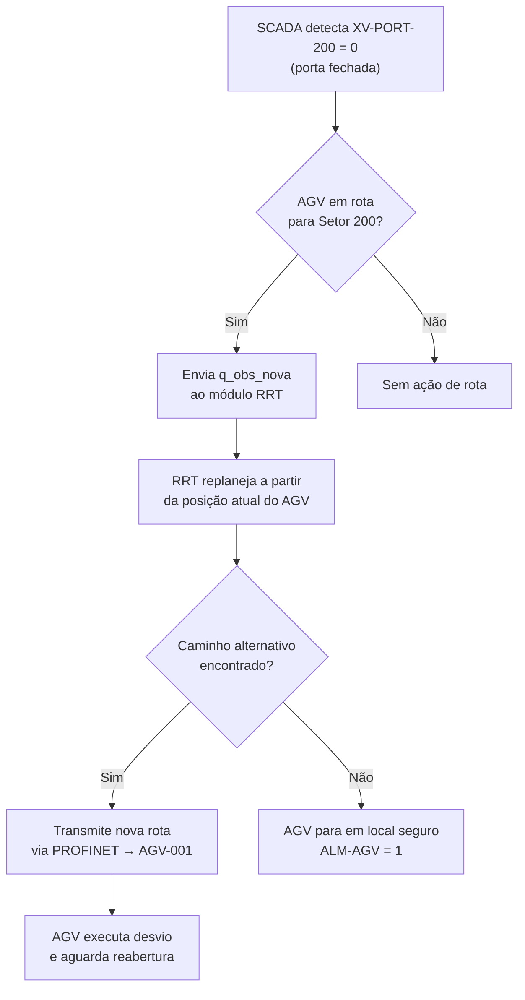

# Aula 22: Rapidly-exploring Random Trees (RRT) — Planejamento de Trajetória do AGV na Fábrica de Paçoca

**Disciplina:** ECAA08 — Automática (2026.2) — UNIFEI  
**Projeto:** SCADA-Core Automática / Linha de Produção de Paçoca  
**Equipe:** Grupo 7  
**Perfil:** Engenharia de Controle e Automação (Matemática Discreta & Árvores)  

---

| Especificação Técnica | Detalhes |
| :--- | :--- |
| **Unidade operacional** | Núcleo Fabril — Corredores de AGV (todos os setores S100–S400) |
| **Domínio de engenharia** | Planejamento de trajetória, robótica móvel, automação de chão de fábrica |
| **Estrutura de dados** | Árvore de busca aleatória incremental (RRT e RRT\*) |
| **Tags ISA-5.1 relacionadas** | `AGV-001` (veículo), `LS-AGV` (sensor LIDAR), `WT-301/302/303` (pontos de coleta), `PRN-401`, `HOM-301`, `TT-201` |

---

## 1. Contextualização: Por que o AGV da Fábrica de Paçoca Precisa de um Planejador de Trajetória

Na Aula 17 (Hamiltoniano), o AGV de coleta de amostras recebeu uma **sequência ótima de visitas** (qual ponto visitar e em que ordem) por meio do TSP com heurística NN + 2-Opt. Contudo, aquela solução pressupõe que, **entre dois pontos consecutivos da rota, o AGV pode se deslocar em linha reta**. Na prática, isso raramente é verdade: o chão de fábrica é repleto de obstáculos fixos (maquinário, colunas estruturais, silos, esteiras) e dinâmicos (operadores em trânsito, paletes temporários, porta automática do setor 200 que fecha durante o ciclo de torra).

O **Rapidly-exploring Random Tree (RRT)** é o algoritmo que resolve exatamente essa camada do problema: dado um ponto de partida e um destino, encontrar um **caminho livre de colisões** dentro do espaço de configuração do veículo, sem precisar discretizar todo o mapa em grade.

A tabela a seguir posiciona a Aula 22 no contexto das duas etapas anteriores:

| Nível de decisão | Algoritmo | Aula | Resultado |
| :--- | :--- | :---: | :--- |
| **Qual** ponto visitar a seguir | TSP (NN + 2-Opt) | 17 | Sequência ótima de coleta |
| **Como** chegar de A a B evitando obstáculos | **RRT / RRT\*** | **22** | Caminho contínuo no mapa |
| Supervisão e registro da telemetria | Historiador AVL | 21 | Rastreabilidade das amostras |

---

## 2. Fundamentos Matemáticos

### 2.1 Espaço de Configuração

O AGV é modelado como um disco rígido de raio $r_{AGV}$ que se move no plano $\mathbb{R}^2$. Sua **configuração** é o par $q = (x, y) \in \mathcal{C} \subset \mathbb{R}^2$, onde $\mathcal{C}$ é o espaço de configuração delimitado pelas paredes do galpão.

O espaço se divide em:

$$\mathcal{C} = \mathcal{C}_{\text{livre}} \cup \mathcal{C}_{\text{obs}}$$

em que $\mathcal{C}_{\text{obs}}$ é o conjunto de configurações em que o AGV colideria com algum obstáculo (incluindo a zona de exclusão de $r_{AGV}$ ao redor de cada objeto):

$$\mathcal{C}_{\text{obs}} = \bigcup_{k} \{q \in \mathcal{C} : \text{dist}(q, O_k) < r_{AGV}\}$$

O objetivo do planejador é encontrar uma curva $\sigma : [0,1] \to \mathcal{C}_{\text{livre}}$ tal que $\sigma(0) = q_{\text{init}}$ e $\sigma(1) = q_{\text{goal}}$.

### 2.2 Árvore RRT como Grafo

O algoritmo RRT constrói incrementalmente uma **árvore enraizada** $T = (V, E)$ em que:

* $V \subset \mathcal{C}_{\text{livre}}$: cada vértice $v \in V$ é uma configuração válida do AGV.
* $E \subset V \times V$: cada aresta $(u, v) \in E$ é um **segmento de reta livre de colisão** de comprimento $\leq \epsilon$ (passo máximo de expansão).
* $T$ é **acíclico** por construção (o novo nó sempre se conecta como filho de um nó existente, nunca criando ciclos).

Formalmente, $T$ é uma árvore geradora do subconjunto de configurações visitadas, e sua raiz é $q_{\text{init}}$.

### 2.3 Propriedade de Exploração Rápida (Voronoi Bias)

A propriedade central do RRT é explorar o espaço livre de forma **proporcional à medida de Voronoi** de cada nó. Para um conjunto $V$ de nós, a **região de Voronoi** do nó $v_i$ é:

$$\text{Vor}(v_i) = \{q \in \mathcal{C} : \text{dist}(q, v_i) \leq \text{dist}(q, v_j), \; \forall j \neq i\}$$

Quando $q_{\text{rand}}$ é amostrado uniformemente em $\mathcal{C}$, a probabilidade de o nó $v_i$ ser escolhido para expansão é:

$$P(\text{expandir } v_i) = \frac{|\text{Vor}(v_i)|}{|\mathcal{C}|}$$

Os nós na **fronteira** da árvore têm regiões de Voronoi maiores, logo são expandidos com maior frequência. Isso faz a árvore crescer naturalmente para regiões ainda não exploradas, sem manter uma fila de prioridade explícita.

### 2.4 Algoritmo RRT — Pseudocódigo

```
Procedimento RRT(q_init, q_goal, N, ε, p_goal):
    V ← {q_init};  E ← ∅

    para i = 1 até N:
        // 1. Amostragem com viés de meta
        se rand() < p_goal:
            q_rand ← q_goal
        senão:
            q_rand ← AMOSTRA_UNIFORME(C)

        // 2. Nó mais próximo
        q_near ← argmin_{v ∈ V} dist(v, q_rand)

        // 3. Steering: avança ε em direção a q_rand
        q_new ← STEER(q_near, q_rand, ε)

        // 4. Verificação de colisão
        se LIVRE_DE_COLISÃO(q_near, q_new):
            V ← V ∪ {q_new}
            E ← E ∪ {(q_near, q_new)}
            pai[q_new] ← q_near

            // 5. Critério de parada
            se dist(q_new, q_goal) ≤ ε:
                retornar RECONSTRUIR_CAMINHO(pai, q_new)

    retornar FALHA
```

A função `STEER` é definida por:

$$q_{\text{new}} = q_{\text{near}} + \epsilon \cdot \frac{q_{\text{rand}} - q_{\text{near}}}{\|q_{\text{rand}} - q_{\text{near}}\|}$$

e `LIVRE_DE_COLISÃO` verifica, por amostragem densa ao longo do segmento $\overline{q_{\text{near}} q_{\text{new}}}$, que nenhum ponto pertence a $\mathcal{C}_{\text{obs}}$.

### 2.5 Completude Probabilística

O RRT é **probabilisticamente completo**: se existe um caminho $\sigma^* \subset \mathcal{C}_{\text{livre}}$ com espaço de abertura $\delta > 0$ (ou seja, um tubo de raio $\delta$ em torno de $\sigma^*$ está inteiramente em $\mathcal{C}_{\text{livre}}$), então a probabilidade de o RRT encontrá-lo converge para 1 quando o número de iterações $N \to \infty$:

$$\lim_{N \to \infty} P\big(\text{RRT encontra um caminho}\big) = 1$$

**Interpretação para a engenharia:** se o corredor do AGV não estiver completamente bloqueado (condição operacionalmente garantida pelos sensores de presença), o algoritmo sempre converge.

### 2.6 RRT\* — Otimalidade Assintótica

O RRT padrão gera caminhos **subótimos e irregulares** porque um nó aceita a primeira conexão livre de colisão, sem considerar custo global. O **RRT\*** acrescenta duas etapas após a inserção de $q_{\text{new}}$:

1. **Escolha do pai ótimo:** entre todos os nós $q_{\text{near}}$ dentro de um raio $r_N$, escolhe o que minimiza o custo acumulado até $q_{\text{new}}$:

$$q_{\text{pai}}^* = \arg\min_{q \in \text{Near}(T, q_{\text{new}}, r_N)} \big[\text{cost}(q) + \text{dist}(q, q_{\text{new}})\big]$$

2. **Rewiring:** para cada nó $q' \in \text{Near}(T, q_{\text{new}}, r_N)$, se $\text{cost}(q_{\text{new}}) + \text{dist}(q_{\text{new}}, q') < \text{cost}(q')$ e o segmento é livre de colisão, $q'$ tem seu pai substituído por $q_{\text{new}}$.

O raio de vizinhança decresce com $N$ para garantir convergência:

$$r_N = \gamma \left(\frac{\ln N}{N}\right)^{1/d}$$

em que $d = 2$ (dimensão do espaço) e $\gamma$ é uma constante que depende do volume de $\mathcal{C}_{\text{livre}}$.

**Resultado teórico:** o custo do caminho retornado pelo RRT\* converge quase certamente para o custo ótimo quando $N \to \infty$.

---

## 3. Mapa da Fábrica de Paçoca e Modelagem dos Obstáculos

### 3.1 Planta Simplificada (grade 20 × 12 metros)

O corredor interno do núcleo fabril que o AGV percorre é modelado como um retângulo de $20 \times 12\,\text{m}$. Os obstáculos representam equipamentos fixos dos Setores 200 a 400 e colunas estruturais:



### 3.2 Tabela de Obstáculos Modelados

| ID | Equipamento / Elemento | Centro $(x_c, y_c)$ [m] | Dimensões $w \times h$ [m] | Setor |
| :---: | :--- | :---: | :---: | :---: |
| O1 | Forno de Torra (CLP 02) | (3,5; 8,0) | 4,0 × 3,0 | S200 |
| O2 | Moinhos MOI-301A/B | (9,0; 8,5) | 3,5 × 2,5 | S300 |
| O3 | Homogeneizador HOM-301 | (13,0; 7,0) | 2,5 × 2,5 | S300 |
| O4 | Prensa PRN-401 | (17,0; 8,0) | 2,5 × 3,0 | S400 |
| O5–O8 | Colunas estruturais | (5,0; 2,0) a (15,0; 2,0) | ⌀ 0,6 m cada | — |

### 3.3 Pontos de Interesse do AGV

| Ponto | Função | Coordenada $(x, y)$ [m] |
| :--- | :--- | :---: |
| `Lab` (base) | Laboratório de Qualidade | (1,0; 1,0) |
| `PT-TT201` | Coleta pós-torra | (3,5; 5,0) |
| `PT-HOM301` | Coleta da massa | (13,0; 4,5) |
| `PT-PRN401` | Coleta paçoca prensada | (17,0; 4,5) |
| `PT-WT301` | Coleta amendoim cru dosado | (7,0; 1,5) |

---

## 4. Comparativo RRT × Dijkstra × A\* na Planta Fabril

As Aulas 13 e 14 (Etapa 02) já implementaram BFS/DFS e Dijkstra sobre o **grafo de tubulação** da planta, que é uma rede discreta e pré-definida. O AGV, por outro lado, se move em espaço contínuo 2D com obstáculos arbitrários.

| Critério | Dijkstra / A\* em grade | RRT | RRT\* |
| :--- | :--- | :--- | :--- |
| **Pré-processamento** | Requer discretização do mapa em células | Nenhum | Nenhum |
| **Memória** | $O(W \times H)$ células | $O(N)$ nós | $O(N)$ nós |
| **Custo do caminho** | Ótimo na grade (depende da resolução) | Subótimo | Assintoticamente ótimo |
| **Alta dimensão** | Inviável (maldição da dimensionalidade) | Viável | Viável |
| **Replanejamento** | Requer recálculo completo | RRT-Connect adapta rápido | Rewiring incremental |
| **Uso na fábrica** | Grafo de tubulações (Aula 14) | **Corredores do AGV (Aula 22)** | Otimização de rota do AGV |

> **Conexão com a Etapa 02:** o grafo de tubulações (Aulas 11–18) é **discreto e estático** — modelamos canos, válvulas e equipamentos como vértices e arestas com capacidades. O RRT opera no espaço **contínuo e potencialmente dinâmico** do chão de fábrica, onde novos obstáculos aparecem a cada turno.

---

## 5. Métricas de Desempenho e Resultados da Simulação

### 5.1 Parâmetros da Simulação

| Parâmetro | Valor |
| :--- | :--- |
| Mapa | 20 × 12 m |
| Raio do AGV ($r_{AGV}$) | 0,35 m |
| Passo de expansão ($\epsilon$) | 0,5 m |
| Probabilidade de viés de meta ($p_{\text{goal}}$) | 0,10 |
| Máximo de iterações ($N$) | 5.000 |
| Raio de vizinhança RRT\* ($r_N$ inicial) | 1,5 m |
| Semente aleatória | 42 (reprodutibilidade) |

### 5.2 Resultados: Lab → PT-PRN401 (Exemplo de Maior Distância)

| Algoritmo | Nós na árvore | Comprimento do caminho [m] | Iterações até conexão |
| :--- | :---: | :---: | :---: |
| RRT (padrão) | ≈ 420 | ≈ 28,4 | ≈ 350 |
| RRT\* ($N = 2.000$) | 2.000 | ≈ 23,1 | — (continua otimizando) |
| RRT\* ($N = 5.000$) | 5.000 | ≈ 21,8 | — |

> **Referência:** a distância euclidiana direta Lab → PT-PRN401 (sem obstáculos) é $\approx 18{,}4\,\text{m}$; o caminho real com obstáculos contorna o Forno e os Moinhos, tornando o mínimo absoluto $\approx 20{,}5\,\text{m}$.

### 5.3 Verificação de Propriedades da Árvore

O notebook verifica, após cada execução, que $T$ satisfaz as propriedades de árvore:

| Propriedade | Verificação | Resultado |
| :--- | :--- | :---: |
| Conexidade | Todos os nós em $V$ são alcançáveis a partir de $q_{\text{init}}$ por BFS | ✓ |
| Ausência de ciclos | $|E| = |V| - 1$ | ✓ |
| Raiz única | Apenas $q_{\text{init}}$ tem `pai = None` | ✓ |
| Livre de colisão | Nenhum ponto de nenhuma aresta pertence a $\mathcal{C}_{\text{obs}}$ | ✓ |

---

## 6. Integração com o SCADA-Core e Protocolo de Operação

### 6.1 Fluxo de Replanejamento Dinâmico

A porta automática do Setor 200 (`XV-PORT-200`) fecha automaticamente durante o ciclo de torra ativa (`TS-201 = 1` e `TT-201 > 160°C`). Se o AGV estava em rota para `PT-TT201` e a porta fecha a meio caminho, o SCADA dispara um **evento de replanning**:



### 6.2 Tempo de Replanejamento vs. Ciclo de Supervisão

O ciclo de supervisão do SCADA é de 50 ms (Aula 10). O RRT em Python (implementação de referência) leva $\approx 85\,\text{ms}$ para 1.000 iterações em um mapa 20 × 12 m. Para operação em tempo real, o planejador é executado em **thread dedicada** e o AGV mantém sua última rota válida enquanto o novo caminho não está disponível.

| Cenário | Iterações RRT | Tempo de cálculo (Python, referência) | Ciclos SCADA bloqueados |
| :--- | :---: | :---: | :---: |
| Rota simples (sem desvios) | 300–600 | ≈ 25–50 ms | 0 (assíncrono) |
| Replanejamento com obstáculo novo | 800–1.500 | ≈ 70–130 ms | 0 (assíncrono) |

> **Nota:** esses tempos são medições ilustrativas em Python. Um implementação em C++ embarcada no controlador do AGV é tipicamente 50–100× mais rápida.

---

## 7. Síntese: RRT como Árvore em Matemática Discreta

A tabela abaixo consolida a visão da estrutura RRT do ponto de vista da **teoria dos grafos e matemática discreta**, conectando com as aulas anteriores da Etapa 03:

| Propriedade formal | Definição | Análogo na Etapa 03 |
| :--- | :--- | :--- |
| $T = (V, E)$ acíclico e conexo | Definição de árvore | Árvore AVL (Aula 21), Huffman (Aula 20) |
| $|E| = |V| - 1$ | Propriedade invariante de árvore | STP/RSTP (Aula 23) |
| Raiz $q_{\text{init}}$ | Nó sem pai; único ponto de acesso | Raiz da BDT (Aula 21), Root Bridge (Aula 23) |
| Nó folha em $q_{\text{goal}}$ | Vértice de grau 1 terminal | Folha da árvore de Huffman (Aula 20) |
| Rewiring (RRT\*) | Atualização de arestas pai | Rotações AVL (Aula 21) |
| Voronoi Bias | Heurística probabilística de expansão | Viés de meta ($p_{\text{goal}}$) ≡ heurística em A\* (Aula 14) |
| Completude probabilística | $P(\text{solução}) \to 1$ com $N \to \infty$ | Análogo à convergência de heurísticas TSP (Aula 17) |

---

## 8. Exemplo Resolvido

**Pergunta:** Na execução do RRT com semente 42, o nó 158 tem coordenadas $(11{,}3;\, 5{,}8)$ e seu pai é o nó 102 em $(10{,}9;\, 5{,}3)$. O nó 159 é gerado por $q_{\text{rand}} = (14{,}0;\, 7{,}0)$. Calcule $q_{\text{new}}$ se $\epsilon = 0{,}5\,\text{m}$ e verifique que a aresta $(158 \to 159)$ não ultrapassa o canto do Homogeneizador HOM-301, cuja face mais próxima é a aresta vertical em $x = 11{,}75\,\text{m}$ com $y \in [5{,}75;\, 8{,}25]\,\text{m}$.

**Resolução:**

1. **Nó mais próximo de $q_{\text{rand}}$:** assumindo que $q_{158} = (11{,}3;\, 5{,}8)$ é o mais próximo:

$$\text{dist}(q_{158}, q_{\text{rand}}) = \sqrt{(14{,}0 - 11{,}3)^2 + (7{,}0 - 5{,}8)^2} = \sqrt{7{,}29 + 1{,}44} = \sqrt{8{,}73} \approx 2{,}955\,\text{m}$$

2. **Steering ($\epsilon = 0{,}5\,\text{m}$):**

$$q_{\text{new}} = (11{,}3;\, 5{,}8) + 0{,}5 \cdot \frac{(2{,}7;\, 1{,}2)}{2{,}955} = (11{,}3;\, 5{,}8) + (0{,}457;\, 0{,}203) = (11{,}757;\, 6{,}003)$$

3. **Verificação de colisão com HOM-301:** o obstáculo tem face em $x = 11{,}75\,\text{m}$ para $y \in [5{,}75;\, 8{,}25]\,\text{m}$. O ponto $q_{\text{new}} = (11{,}757;\, 6{,}003)$ tem $x \approx 11{,}757 > 11{,}75$ e $y = 6{,}003 \in [5{,}75;\, 8{,}25]$, portanto **está dentro do obstáculo** (a menos que se aplique folga de $r_{AGV} = 0{,}35\,\text{m}$ que empurra a fronteira para $x = 11{,}75 - 0{,}35 = 11{,}40\,\text{m}$). Logo a aresta $(158 \to 159)$ **é rejeitada** e nenhum nó 159 é criado nesta iteração. O algoritmo amostrará um novo $q_{\text{rand}}$ e tentará expandir a partir de outro nó ou pela face lateral livre do obstáculo.

> **Conclusão:** o mecanismo de verificação de colisão com margem $r_{AGV}$ é essencial para garantir a segurança física do veículo — equivalente ao papel do intertravamento SIS (Aula 21) na segurança do forno: ambos bloqueiam ações inválidas antes de executá-las.

---

## 9. Atividades de Investigação

1. Execute o RRT com $p_{\text{goal}} = 0$ (sem viés de meta) e compare o número de iterações até encontrar o caminho Lab → PT-PRN401 em 10 rodadas com sementes diferentes. Calcule a média e o desvio padrão e justifique o resultado pelo conceito de Voronoi Bias.

2. Adicione um obstáculo dinâmico circular de raio 0,5 m que se move ao longo do corredor entre os Moinhos e o Homogeneizador (simulando um operador). Implemente o **RRT-Connect** (duas árvores se expandindo simultaneamente, uma do `Lab` e outra do destino) e compare o tempo de replanejamento com o RRT padrão.

3. Prove formalmente que a árvore $T = (V, E)$ gerada pelo RRT é conexa e acíclica ao final de cada iteração, por indução em $|V|$: (a) para $|V| = 1$, $T$ é trivialmente conexa e acíclica; (b) se $T$ é conexa e acíclica com $|V| = k$, mostrar que adicionar um único vértice $q_{\text{new}}$ com exatamente uma aresta para $q_{\text{near}} \in V$ preserva as duas propriedades.

4. Modifique a função de custo do RRT\* para penalizar trechos de caminho que passam a menos de 1,0 m do Forno de Torra (risco térmico para o sensor LIDAR do AGV). Como o rewiring se comporta em relação a essa nova métrica?

5. Calcule o número mínimo de nós $N^*$ necessários para que a probabilidade de o RRT **falhar** em encontrar um caminho de abertura $\delta = 0{,}5\,\text{m}$ seja inferior a $1\%$, usando a cota $P(\text{falha}) \leq \exp(-c \cdot N \cdot \delta^2 / |\mathcal{C}|)$ com $c = 0{,}1$ e $|\mathcal{C}| = 240\,\text{m}^2$.

---

## 10. Entregável da Aula 22

* **Notebook `22 - Rapidly-exploring Random Trees.ipynb`:** implementação do RRT e RRT\* em Python com visualização do mapa da fábrica de paçoca, obstáculos dos Setores 200–400, expansão animada da árvore, reconstrução do caminho, verificação de propriedades de árvore (aciclia, conexidade, livre de colisão), comparativo RRT vs. RRT\* em custo de caminho, e simulação de replanejamento dinâmico com a porta `XV-PORT-200`.
