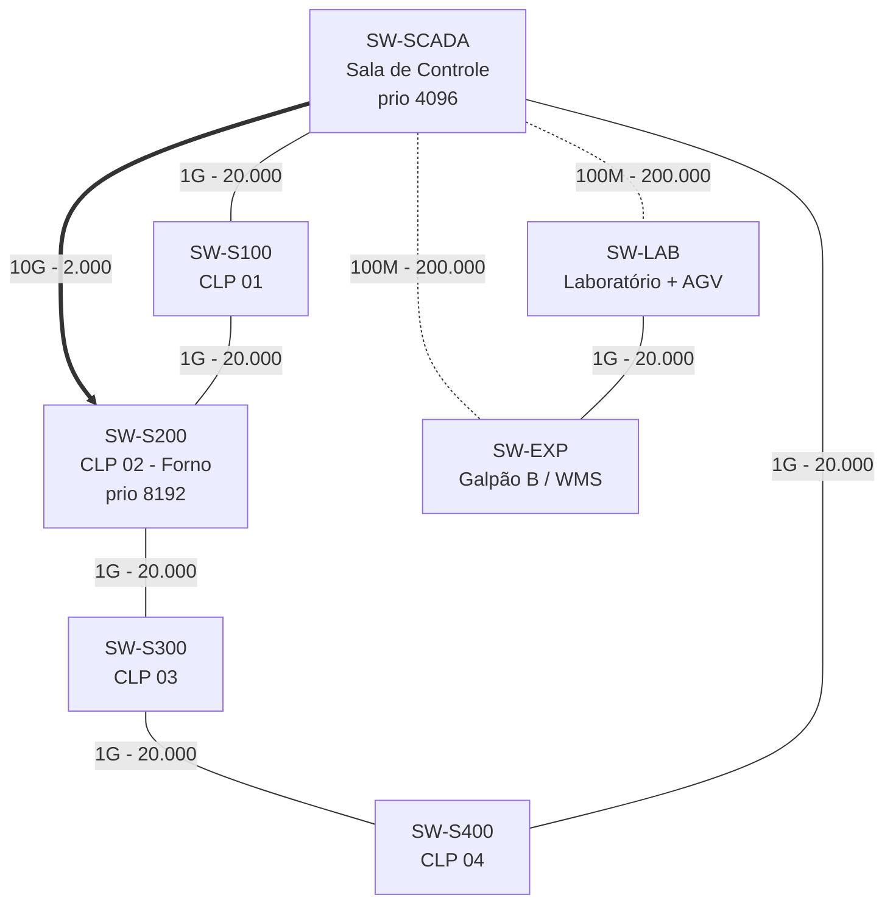

# Aula 23: Protocolo de Árvore Geradora (STP / RSTP) — Rede Industrial da Fábrica de Paçoca

**Disciplina:** ECAA08 — Automática (2026.2) — UNIFEI  
**Projeto:** SCADA-Core Automática / Linha de Produção de Paçoca  
**Equipe:** Grupo 7  
**Perfil:** Engenharia de Controle e Automação (Matemática Discreta & Árvores)  

---

## 1. Contextualização: Por que a Rede da Fábrica de Paçoca Precisa de uma Árvore

Na Etapa 01, o SCADA-Core foi organizado em quatro CLPs, um por setor da linha (`CLP 01` recepção/limpeza, `CLP 02` torra/despeliculagem, `CLP 03` dosagem/moagem, `CLP 04` prensagem/embalagem), integrados por rede industrial PROFINET/Modbus TCP. Na Etapa 02 surgiram dois pontos externos ao núcleo fabril que também precisam de comunicação: o **Laboratório de Qualidade** (base do AGV de amostragem da Aula 17) e o **Galpão B de Expedição** (WMS das ruas 1 a 4, Aula 18).

Para que a perda de um único cabo não deixe um setor sem supervisão, a rede física tem **enlaces redundantes**, o que cria ciclos. Em Ethernet (camada 2) ciclos são proibidos na operação: o quadro IEEE 802.3 não tem campo TTL, então um *broadcast* (ARP, descoberta de dispositivos PROFINET) circula indefinidamente e satura a rede (*broadcast storm*), além de fazer os switches aprenderem o mesmo MAC em portas diferentes (*MAC flapping*).

O **STP (IEEE 802.1D)** e o **RSTP (IEEE 802.1w)** resolvem isso escolhendo, de forma distribuída, um subconjunto de enlaces que forma uma **árvore geradora** do grafo físico; os demais enlaces ficam bloqueados logicamente, em *standby*.

Os riscos específicos da nossa planta orientam as decisões de projeto:

* **Setor 200 (forno de torra):** gás natural/GLP, operação abaixo do limite de segurança de 160 °C (`TT-201`), intertravamento de chama (`TS-201`, `XV-201`) — é o setor que mais exige visibilidade contínua no SCADA.
* **Setor 200 também concentra tráfego:** a selecionadora óptica com câmeras RGB lineares gera fluxo de imagens contínuo.
* **Setor 400 e Expedição:** detecção de metais (`MD-401`) e bloqueio de expedição (`POP-SEG-01`, Aula 10) — se o CLP 04 não conseguir avisar o WMS, um palete contaminado pode ser expedido (falha de rastreabilidade HACCP).

---

## 2. Fundamentação em Matemática Discreta

### 2.1. Modelo do grafo

A rede de switches é um grafo **não-dirigido, conexo e ponderado** $G = (V, E, w)$:

* $V = \{\text{SW-SCADA}, \text{SW-S100}, \text{SW-S200}, \text{SW-S300}, \text{SW-S400}, \text{SW-LAB}, \text{SW-EXP}\}$, $|V| = 7$.
* $E$ = enlaces físicos (fibra ou cobre). Na topologia inicial (v1), $|E| = 9$.
* $w: E \to \mathbb{N}$ = custo de porta definido pela norma IEEE 802.1w, inversamente proporcional à velocidade:

| Velocidade | Custo 802.1w | Uso na fábrica de paçoca |
| :--- | :---: | :--- |
| 10 Gbps | 2.000 | Backbone Sala de Controle ↔ Setor 200 (forno + selecionadora óptica) |
| 1 Gbps | 20.000 | Anel de fibra que acompanha a linha S100 → S200 → S300 → S400 |
| 100 Mbps | 200.000 | Cobre legado até o Laboratório e o Galpão B |

### 2.2. Quantos enlaces precisam ser bloqueados?

Toda árvore geradora tem exatamente $|V| - 1$ arestas. Logo o RSTP precisa bloquear

$$|E| - (|V| - 1) = 9 - 6 = 3 \text{ enlaces},$$

que é exatamente o **número ciclomático** $\mu(G) = |E| - |V| + 1 = 3$ (dimensão do espaço de ciclos, já usada na Aula 12). Cada enlace bloqueado "quebra" um ciclo independente.

### 2.3. O RSTP **não** calcula a Árvore Geradora Mínima

É comum ler que o STP calcula uma MST. Isso não é correto, e a diferença importa:

| | Kruskal / Prim (Aula 19) | STP / RSTP |
| :--- | :--- | :--- |
| Objetivo | Minimizar a **soma** dos pesos da árvore | Minimizar o custo de **cada switch até a raiz** |
| Raiz | Não existe | *Root Bridge* eleito pelo menor BID |
| Árvore obtida | Árvore Geradora Mínima (MST) | Árvore de Caminhos Mínimos (SPT), equivalente a um Dijkstra a partir da raiz (Aula 14) |

As duas coincidem em muitas redes, mas não na nossa topologia v1 (Seção 4.2). Para tráfego supervisório, que converge quase todo para os servidores SCADA, a SPT é o critério correto.

### 2.4. Algoritmo do RSTP no estado convergido

1. **Eleição do Root Bridge:** menor $\text{BID} = (\text{priority}, \text{MAC})$, comparado lexicograficamente.
2. **Root Path Cost:** $d(v) = $ menor soma de custos de $v$ até a raiz.
3. **Root Port (RP)** de cada switch não-raiz: porta que minimiza $(d(\text{vizinho}) + w, \text{BID do vizinho})$.
4. **Designated Port (DP)** de cada enlace: extremidade com menor $(d, \text{BID})$.
5. **Alternate Port (AP):** porta que não é RP nem DP → estado *Discarding*. No RSTP ela mantém um caminho pré-calculado para a raiz e assume como RP sem esperar temporizadores.

### 2.5. Pontos de articulação e pontes

Um **ponto de articulação** é um vértice cuja remoção desconecta o grafo; uma **ponte** é uma aresta com a mesma propriedade. Ambos são encontrados pelo algoritmo de **Tarjan** em $O(|V| + |E|)$ com uma DFS que registra, para cada vértice, o tempo de descoberta `desc[u]` e o menor tempo alcançável pela subárvore `low[u]`:

* $u$ (não-raiz da DFS) é articulação se existe filho $v$ com $\text{low}[v] \ge \text{desc}[u]$;
* a raiz da DFS é articulação se tem mais de um filho;
* $(u, v)$ é ponte se $\text{low}[v] > \text{desc}[u]$.

Esse teste é o que diz se o RSTP **pode** proteger a rede: nenhum protocolo de camada 2 cria um caminho que não existe fisicamente.

---

## 3. Arquitetura da Rede da Fábrica de Paçoca

### 3.1. Switches e prioridades

| Switch | Local / equipamentos ligados | Bridge Priority | Papel planejado |
| :--- | :--- | :---: | :--- |
| `SW-SCADA` | Sala de Controle: servidores SCADA, historiador, IHMs das Telas 01–04 | **4096** | Root Bridge primário |
| `SW-S200` | CLP 02, forno de torra, selecionadora óptica, despeliculadores | **8192** | Root Bridge secundário |
| `SW-S100` | CLP 01, peneiras `M-101`, secador, silo `LT-101` | 32768 | — |
| `SW-S300` | CLP 03, balanças `WT-301/302/303`, moinhos, `HOM-301` | 32768 | — |
| `SW-S400` | CLP 04, prensa, `VS-401`, `MD-401`, embaladora | 32768 | — |
| `SW-LAB` | Laboratório de Qualidade, ponto de acesso Wi-Fi do AGV | 32768 | — |
| `SW-EXP` | Galpão B, WMS, docas | 32768 | — |

**Por que o Setor 200 como raiz secundária?** Se o switch da Sala de Controle falhar, a árvore se reancora no setor de maior risco e de maior tráfego, que já possui o enlace mais rápido. Deixar todos com 32768 faria a eleição depender do MAC, ou seja, de qual equipamento foi comprado primeiro.

### 3.2. Topologia física v1

O anel de 1 Gbps segue o próprio fluxo do produto (recepção → torra → moagem → prensa) e fecha na Sala de Controle. Lab e Galpão B chegam por cobre legado e foram interligados entre si por uma fibra mais nova.

---

## 4. Resultados da Simulação (notebook `23 - Protocolo de Arvore Geradora STP RSTP.ipynb`)

### 4.1. Convergência em operação normal (v1)

| Switch | Root Path Cost | Root Port |
| :--- | ---: | :--- |
| `SW-SCADA` | 0 | — (raiz) |
| `SW-S200` | 2.000 | para `SW-SCADA` |
| `SW-S100` | 20.000 | para `SW-SCADA` |
| `SW-S400` | 20.000 | para `SW-SCADA` |
| `SW-S300` | 22.000 | para `SW-S200` |
| `SW-LAB` | 200.000 | para `SW-SCADA` |
| `SW-EXP` | 200.000 | para `SW-SCADA` |

Enlaces bloqueados (3, como previsto): `S100 ↔ S200` (AP no S100), `S300 ↔ S400` (AP no S300) e `LAB ↔ EXP` (AP no EXP).

### 4.2. SPT do RSTP × MST de Kruskal

| | SPT (RSTP) | MST (Kruskal) |
| :--- | ---: | ---: |
| Peso total da árvore | 462.000 | **282.000** |
| Custo do `SW-S400` até a raiz | **20.000** | 42.000 |
| Custo do `SW-EXP` até a raiz | **200.000** | 220.000 |

A MST tem peso total menor porque troca `S400 ↔ SCADA` por `S300 ↔ S400` e `EXP ↔ SCADA` por `LAB ↔ EXP`. Em troca, os dados do CLP 04 (`MD-401`, `VS-401`) e do WMS passariam a percorrer caminhos mais longos até o SCADA. Isso confirma a Seção 2.3: o RSTP otimiza o caminho de cada switch até a raiz, não o custo total.

A SPT também revela uma fragilidade: Lab e Expedição usam o cobre de 100 Mbps, porque o caminho pela fibra custaria $200.000 + 20.000 = 220.000 > 200.000$. O protocolo está correto; quem precisa ser revisto é o projeto físico.

### 4.3. Falha 1 — rompimento do backbone `SW-SCADA ↔ SW-S200`

| Switch | Porta para | Antes | Depois |
| :--- | :--- | :---: | :---: |
| `SW-S200` | `SW-SCADA` | RP | rompida |
| `SW-S200` | `SW-S100` | DP | **RP** |
| `SW-S100` | `SW-S200` | AP | **DP** |
| `SW-S300` | `SW-S400` | AP | **RP** |
| `SW-S300` | `SW-S200` | RP | **AP** |

O forno passa a ser supervisionado pelo anel (custo 40.000 em vez de 2.000) e a telemetria de `TT-201`, `TS-201` e `FS-201` não é perdida. O `SW-S200` fica sem *Alternate* própria, anuncia BPDUs inferiores e o `SW-S100`, que conhece um caminho melhor até a raiz, transforma a sua porta em *Designated* via *Proposal/Agreement*.

### 4.4. Falha 2 — perda do Root Bridge e o ponto de articulação

O algoritmo de Tarjan aponta **`SW-SCADA` como ponto de articulação** da topologia v1 (e nenhuma ponte). Sem ele:

* o núcleo fabril {S100, S200, S300, S400} elege o `SW-S200` como raiz, como planejado;
* {LAB, EXP} vira uma **ilha isolada** que elege o próprio `SW-LAB` como raiz.

Consequência operacional: o CLP 04 não consegue informar ao WMS que um palete foi bloqueado por contaminação metálica, e o Lab não consegue publicar liberações de lote. Um único equipamento compromete a rastreabilidade.

### 4.5. Correção de projeto — topologia v2

Foi adicionada uma fibra de 1 Gbps **`SW-S400 ↔ SW-EXP`**, seguindo o caminho físico do produto (embalagem → paletização → Galpão B). Resultados:

* $|E| = 10$, $\mu(G) = 4$; **nenhum ponto de articulação e nenhuma ponte** (grafo 2-conexo).
* Lab e Expedição passam a usar fibra (`EXP` = 40.000 via S400, `LAB` = 60.000 via EXP) e os dois cobres legados ficam bloqueados, como reserva.
* Sem o `SW-SCADA`, a rede continua com **uma única ilha**, com raiz no `SW-S200`.
* Na v2 a SPT e a MST passam a ter o mesmo peso (102.000).

### 4.6. Teste de contingência N-1

Foram simuladas todas as falhas simples (cada enlace e cada switch, um por vez), verificando conectividade e se o subgrafo lógico é uma árvore geradora ($|E_T| = |V_T| - 1$, conexo e acíclico, checado por *Union-Find*):

| Topologia | Cenários | Atendidos | Falha não atendida |
| :--- | :---: | :---: | :--- |
| v1 | 16 | 15 | perda do `SW-SCADA` (2 ilhas) |
| **v2** | **17** | **17** | — |

Em todos os cenários a árvore lógica foi válida: o RSTP nunca deixou ciclos ativos.

### 4.7. Tempo de convergência × supervisão e rastreabilidade

Premissas do grupo: ciclo de supervisão de 50 ms (Aula 10) e capacidade de 500 kg/h (Aula 15). Tempos de convergência são valores típicos de referência.

| Protocolo / cenário | Convergência | Ciclos de supervisão perdidos | Paçoca produzida sem registro no SCADA |
| :--- | :---: | :---: | :---: |
| STP — falha indireta (*Max Age* + 2 × *Forward Delay*) | 50 s | 1.000 | 6,94 kg |
| STP — perda de link detectada | 30 s | 600 | 4,17 kg |
| RSTP — falha percebida só por BPDU (3 × *Hello*) | 6 s | 120 | 0,83 kg |
| MRP (IEC 62439-2), classe 200 ms | 0,2 s | 4 | 0,03 kg |
| RSTP — *Alternate Port* pronta (típico) | 0,05 s | 1 | 0,007 kg |

Com STP clássico, quase 7 kg de paçoca poderiam ficar sem registro de rastreabilidade, e o lote correspondente precisaria ser segregado. Com RSTP ou MRP, a perda fica em gramas. Por isso o RSTP é obrigatório na v2, e o MRP é a alternativa natural se todos os switches forem PROFINET com suporte ao protocolo.

---

## 5. Proteções de Borda Recomendadas

| Recurso | Onde habilitar na fábrica de paçoca | Motivo |
| :--- | :--- | :--- |
| **Edge Port / PortFast** | Portas de CLPs, IHMs locais, câmeras da selecionadora e do `VS-401`, balanças, AP do AGV | Entram direto em *Forwarding* e não geram *Topology Change* quando um equipamento reinicia (ex.: troca de câmera após lavagem) |
| **BPDU Guard** | Todas as *Edge Ports* | Um cabo ligado em laço dentro de um painel de campo coloca só aquela porta em *err-disabled*, sem derrubar o anel |
| **Root Guard** | Portas do `SW-SCADA` e do `SW-S200` voltadas aos demais switches | Impede que um switch de manutenção ligado no painel do Lab ou da Expedição vire raiz e desvie o tráfego do forno |

---

## 6. Nota de Segurança Funcional

O RSTP aumenta a **disponibilidade da supervisão**, mas não faz parte da camada de segurança. O corte de gás do forno (`XV-201`), as paradas de emergência (`ESD-100`, `ESD-400`) e o trip por sobretemperatura continuam implementados em malhas *hardwired* (4–20 mA e contatos secos normalmente fechados) no sistema instrumentado de segurança, independentes da rede Ethernet, conforme a separação de camadas de proteção da IEC 61511 adotada na Etapa 01.

---

## 7. Exemplo Resolvido

**Pergunta:** Na topologia v1, por que a porta bloqueada do enlace `S300 ↔ S400` fica no `SW-S300` e não no `SW-S400`?

**Resolução:** O enlace não pertence à árvore, então uma extremidade é *Designated* e a outra *Alternate*. Compara-se $(d, \text{BID})$:

$$d(\text{S400}) = 20.000 < d(\text{S300}) = 22.000$$

Logo o `SW-S400` oferece o melhor caminho até a raiz naquele segmento e sua porta é *Designated*; a porta do `SW-S300` fica em *Alternate / Discarding*. É justamente essa porta que vira *Root Port* na Falha 1, quando o custo do S300 pelo S200 sobe para 60.000 e o caminho pelo S400 passa a custar 40.000.

---

## 8. Atividades de Investigação

1. Configure manualmente o custo dos enlaces de cobre legados para 2.000.000 na v1. O Lab e a Expedição passam a usar a fibra? A topologia deixa de ter ponto de articulação? Justifique a diferença entre as duas perguntas.
2. Rode o teste N-1 removendo **dois** elementos ao mesmo tempo (N-2) na v2. Quais pares de falhas ainda particionam a rede? Algum deles isola o Setor 200?
3. Construa um exemplo de 3 switches em que a SPT e a MST diferem e prove, pela definição de MST, que a SPT não pode ter peso menor que a MST em nenhum grafo.
4. Troque a prioridade do `SW-S200` para 32768 e repita a Falha 2. Qual switch vira raiz? O resultado depende de quê, e por que isso é ruim em uma planta real?

---

## 9. Entregável da Aula 23

* **Simulador RSTP em Python** (`executar_rstp`): eleição de raiz, *Root Path Cost*, papéis e estados de porta, com suporte a redes particionadas.
* **Comparador SPT × MST** com Kruskal e *Union-Find*.
* **Detector de pontos de articulação e pontes** (Tarjan) e **teste de contingência N-1** com asserções formais.
* **Proposta de topologia v2** para a fábrica de paçoca, tolerante a qualquer falha simples.
